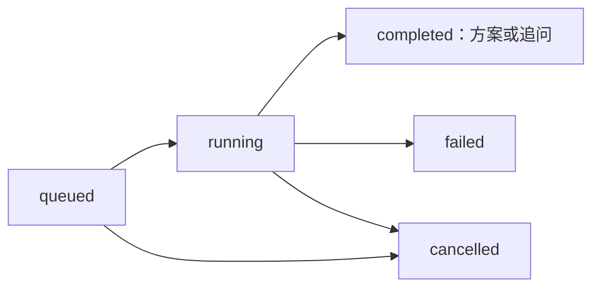

# 路线规划 Agent 接口文档 v1.0

更新日期：2026-10-10。本文依据当前 `route_agent/app.py`、`models.py`、`tools.py` 实现整理。
供 Android 客户端、后端接入和联调使用；不代表这些接口已经部署到现有服务器。

机器可读文档：[openapi.json](./openapi.json)，可导入 Apifox、Postman 或 Swagger Editor。
请求 schema 从当前 FastAPI 应用导出；响应 schema 按当前返回对象补充。

## 1. 地址、鉴权与返回格式

`BASE_URL` 是部署后的 Agent 服务或网关地址，例如 `https://your-agent.example`。
独立服务和网关均使用下列完整路径：

| 方法 | 路径 | 用途 | 成功 HTTP 状态 |
| --- | --- | --- | --- |
| POST | `/routes/agent/runs` | 创建一轮异步规划 | 202 |
| GET | `/routes/agent/runs/{runId}` | 查询阶段、事件与结果 | 200 |
| DELETE | `/routes/agent/runs/{runId}` | 取消规划 | 200 |
| GET | `/health` | 本服务健康检查，无需登录 | 200 |

前三个接口均需：

```http
Authorization: Bearer <现有系统登录token>
Content-Type: application/json
```

`Content-Type` 仅在 POST 携带 JSON 请求体时需要。`Bearer ` 前缀按当前实现区分大小写。
服务端验证 token 得到账号 ID，不信任请求中自行填写的 `accountId`。
查询和取消必须属于当前登录账号；访问其他账号的记录统一返回 404。

**成功响应是直接 JSON 对象，不包裹在原后端的 `{code,msg,data}` 中。**
模型密钥、高德 Web 服务 Key 配置在服务端，不属于请求参数。

## 2. 创建规划

### `POST /routes/agent/runs`

一次请求代表一轮用户对话。创建任务后立即返回，模型和工具查询在后台执行。

请求示例：

```json
{
  "requestId": "7e547d16-f693-4c21-b143-0123456789ab",
  "memoryId": "user-1-route-conversation-01",
  "accountId": 1,
  "message": "南京亲子历史研学，控制在4小时，预算每人200元，尽量少走路，必须去南京博物院",
  "history": [],
  "currentRoute": [],
  "constraints": {
    "city": "南京",
    "date": "2026-10-11",
    "days": 1,
    "dailyMinutes": 240,
    "startTime": "09:00",
    "finishByTime": "13:00",
    "budget": 200,
    "maxWalkingMeters": 2000,
    "modes": ["walking", "transit"],
    "mustVisit": ["南京博物院"],
    "avoid": [],
    "interests": ["历史文化"],
    "group": "2名成人和1名8岁儿童",
    "accessibility": "",
    "pace": "relaxed",
    "returnToStart": false
  },
  "origin": {
    "longitude": 118.79,
    "latitude": 32.06
  }
}
```

以上日期仅作字段示例；联调时替换为实际出行日期及与 token 一致的账号。

### 顶层字段

| 字段 | 类型 | 必填 | 规则 / 默认值 |
| --- | --- | --- | --- |
| `requestId` | string | 是 | 每轮唯一；1～100 位，只允许字母、数字、`_`、`-`；建议 UUID |
| `memoryId` | string | 是 | 会话标识；1～160 位，同上字符集；同一对话持续复用 |
| `accountId` | integer | 是 | 大于 0，必须等于登录身份，否则 403 |
| `message` | string | 是 | 本轮用户需求，去除首尾空格后 1～4000 字符 |
| `history` | Turn[] | 否 | 默认 `[]`；最多 24 条，按时间从旧到新 |
| `currentRoute` | CurrentStop[] | 否 | 默认 `[]`；最多 20 个不同 POI，按当前游览顺序传入 |
| `constraints` | Constraints | 否 | 默认使用下表默认值；通常传上轮返回的约束 |
| `origin` | Origin 或 null | 否 | 默认 null；仅传用户授权定位得到的坐标 |

除 `currentRoute` 元素外，输入对象中的未知字段会被拒绝（422）。
数字不能为 NaN 或 Infinity。可选不代表均可传 null，只有明确标注可空的字段支持 null。

### 对话、当前路线与定位

| 对象 | 字段 | 规则 |
| --- | --- | --- |
| Turn | `role` | `user` 或 `assistant`；不能传 `system`、`tool` |
| Turn | `content` | 1～8000 字符 |
| CurrentStop | `poiId` | 必填；1～80 位字母、数字、`_`、`-`；全程不能重复 |
| CurrentStop | `name` | 可选，默认空字符串，最多 160 字符 |
| CurrentStop | `recommendedDuration` | 可选，默认 60，0～960 分钟 |
| CurrentStop | `notes` | 可选，可为 null，最多 2000 字符 |
| Origin | `longitude` | 必填，经度，73～136 |
| Origin | `latitude` | 必填，纬度，3～54 |

`currentRoute` 可携带原 `RouteNode` 的其他字段；服务端忽略它们，重新按 POI ID 核验详情和坐标。
`origin` 沿用高德 SDK 提供的经纬度；提供定位不意味着用户选择该城市作为旅游目的地。

### Constraints

| 字段 | 类型 | 默认值 | 范围 / 含义 |
| --- | --- | --- | --- |
| `city` | string | `""` | 最多 80 字符；目的城市，缺少决定性信息时 Agent 追问 |
| `date` | string 或 null | null | `YYYY-MM-DD`，行程第一天日期 |
| `days` | integer | 1 | 1～7 天 |
| `dailyMinutes` | integer | 480 | 每日 30～960 分钟，含已规划交通、停留、休息、等待和缓冲 |
| `startTime` | string | `09:00` | 每天开始时间，24 小时制 `HH:mm` |
| `finishByTime` | string 或 null | null | 每天最晚结束时间，24 小时制 `HH:mm` |
| `budget` | number 或 null | null | 每人全程预算，0～1000000 元；null 表示未设上限 |
| `maxWalkingMeters` | integer 或 null | null | 每日通勤步行上限，0～100000 米；不含未测得的场馆内部步行 |
| `modes` | string[] | `["walking","transit"]` | 接受的交通方式，1～3 项；`walking`、`transit`、`driving` |
| `mustVisit` | string[] | `[]` | 必去地点名称或 POI ID，最多 20 项，每项 1～160 字符 |
| `avoid` | string[] | `[]` | 避开地点名称或 POI ID，同上 |
| `interests` | string[] | `[]` | 研学兴趣，最多 12 项，每项 1～160 字符 |
| `group` | string | `""` | 同行人及年龄信息，最多 300 字符 |
| `accessibility` | string | `""` | 无障碍需求，最多 300 字符；设施是否满足需运营方确认 |
| `pace` | string | `balanced` | `relaxed`、`balanced`、`intensive` |
| `returnToStart` | boolean | false | 是否安排返回每天出发点的交通 |

`message` 中的新要求优先于历史偏好。约束可以由模型通过工具提取、更新；
当前实现还会规则提取常见中文数值时长、预算、步行上限。它并不是任意自然语言约束的形式化证明。
预算校验针对已统计估算，存在未知费用时会警示，不能承诺实际总费用必定满足预算。

### 创建响应（HTTP 202）

```json
{
  "runId": "a67f99cfbb9f4532a1ee009988776655",
  "status": "queued",
  "stage": "等待规划",
  "events": [],
  "result": null,
  "error": null
}
```

`runId` 是 32 位小写十六进制任务 ID，与原后端的整数 `routeId` 不同。
202 只表示任务已接受，不能据此显示“路线生成成功”。幂等重试也返回 202，任务可能已处于终态。

## 3. 查询进度与结果

### `GET /routes/agent/runs/{runId}`

无需请求体。推荐约每 1.8～2 秒轮询，终态后停止。

| Run 字段 | 类型 | 含义 |
| --- | --- | --- |
| `runId` | string | 任务标识 |
| `status` | string | `queued`、`running`、`completed`、`failed`、`cancelled` |
| `stage` | string | 可直接展示的阶段文案，不应用作枚举判断 |
| `events` | ToolEvent[] | 最近最多 110 条事件；每次查询返回当前列表，并非增量流 |
| `result` | AgentPlan / Clarification / null | 完成时的方案或追问；其他状态通常为 null |
| `error` | string 或 null | 任务失败说明；读取接口可能 HTTP 200，但任务 `status=failed` |

状态流转：



工具事件示例：

```json
{
  "tool": "build_itinerary",
  "label": "校验行程与约束",
  "status": "needs_revision",
  "elapsedMs": 840
}
```

事件 `status` 为 `running`、`completed`、`failed` 或 `needs_revision`。
单个工具失败或发现约束冲突时 Agent 可以继续调整，不能把事件失败直接当成整轮失败。
最初的“理解需求”事件可能没有 `tool`，运行中事件可能没有 `elapsedMs`。

### 完成方案：`result.kind=plan`

以下是独立的响应结构示例，不是上面请求的真实返回；名称、POI、价格和路线均为示意数据。
真实服务必须以工具结果生成这些字段，不能把示例当作出游方案。

```json
{
  "runId": "a67f99cfbb9f4532a1ee009988776655",
  "status": "completed",
  "stage": "方案已完成",
  "events": [],
  "result": {
    "kind": "plan",
    "message": "建议选择两个相邻场馆，保留休息时间，适合亲子历史观察与记录。",
    "assumptions": ["从第一站开始计时，未计入酒店到第一站交通"],
    "constraints": {"city": "南京", "days": 1, "dailyMinutes": 240},
    "feasible": true,
    "issues": [],
    "warnings": ["费用为估算，预约与出行日开放时间需复查", "有1项费用未核实"],
    "nodes": [
      {"poiId": "DEMO_POI_A", "name": "示例博物馆A", "address": "示例地址A", "cityname": "南京市", "citycode": "025", "adcode": "320102", "type": "科教文化服务", "typecode": "140100", "location": "118.790000,32.060000", "visitOrder": 1, "visitTime": "2026-10-11 09:00", "recommendedDuration": 60, "notes": "观察历史展陈并完成记录卡", "opentimeToday": "09:00-17:00", "opentimeWeek": "", "tel": ""},
      {"poiId": "DEMO_POI_B", "name": "示例场馆B", "address": "示例地址B", "cityname": "南京市", "citycode": "025", "adcode": "320102", "type": "科教文化服务", "typecode": "140100", "location": "118.800000,32.060000", "visitOrder": 2, "visitTime": "2026-10-11 11:10", "recommendedDuration": 60, "notes": "比较两处展陈的历史叙事", "opentimeToday": "09:00-17:00", "opentimeWeek": "", "tel": ""}
    ],
    "days": [{
      "day": 1,
      "date": "2026-10-11",
      "schedule": [
        {"poiId": "DEMO_POI_A", "name": "示例博物馆A", "arrival": "09:00", "departure": "10:00", "minutes": 60, "learningGoal": "观察历史展陈并完成记录卡"},
        {"type": "break", "arrival": "10:00", "departure": "10:45", "minutes": 45},
        {"poiId": "DEMO_POI_B", "name": "示例场馆B", "arrival": "11:10", "departure": "12:10", "minutes": 60, "learningGoal": "比较两处展陈的历史叙事"}
      ],
      "totalMinutes": 190,
      "walkingMeters": 1200,
      "estimatedCost": 100,
      "legCount": 1,
      "finishTime": "12:10"
    }],
    "legs": [{
      "day": 1,
      "origin": "DEMO_POI_A",
      "destination": "DEMO_POI_B",
      "originName": "示例博物馆A",
      "destinationName": "示例场馆B",
      "mode": "walking",
      "minutes": 20,
      "distanceMeters": 1200,
      "walkingMeters": 1200,
      "cost": null,
      "polyline": [[118.79,32.06],[118.795,32.063],[118.80,32.06]],
      "instructions": ["示例道路说明"],
      "source": "高德路径规划",
      "note": "查询时参考结果，不保证未来交通情况"
    }],
    "estimatedCost": 100,
    "unknownCosts": 1,
    "addedPoiIds": ["DEMO_POI_A", "DEMO_POI_B"],
    "removedPoiIds": [],
    "requiresAcceptance": true
  },
  "error": null
}
```

真实响应的 `constraints` 包含全部约束字段；上例为缩短篇幅只列部分字段。

| Plan 字段 | 说明 |
| --- | --- |
| `message` | 推荐理由、方案说明 |
| `assumptions` | 非决定性缺失所采用的假设 |
| `constraints` | 本轮更新后的完整约束，下一轮可以继续传入 |
| `feasible` / `issues` | 已通过当前硬约束检查才可完成；正常完成方案为 true / `[]` |
| `warnings` | 未核实条件、天气/预约/费用等提示；可行不代表所有条件均已证实 |
| `nodes` | 有序地点，可转换为原 `RouteNode`；`visitOrder` 从 1 开始，`recommendedDuration` 单位分钟 |
| `days` | 每日行程、总分钟数、通勤步行米数、费用估算、交通段数、结束时间 |
| `legs` | 独立交通段，`day` 从 1 开始；不能把不同天或不连续段强行连接 |
| `estimatedCost` | 每人全程已统计费用估算，单位元；不是完整费用承诺 |
| `unknownCosts` | 尚未统计的地点/交通费用项数，不是人数 |
| `addedPoiIds` / `removedPoiIds` | 相对请求中当前路线的地点增删列表 |
| `requiresAcceptance` | 当前实现始终 true，用户确认应用后才替换客户端路线 |

`nodes.location` 为字符串 `经度,纬度`；`legs.polyline` 为二维数组 `[[经度,纬度],...]`。
`leg.minutes` 是交通参考时间，`day.totalMinutes` 还计入每段 5 分钟缓冲、停留、休息和开放等待。
`leg.cost` 目前仅公交返回有效费用时有值，其他情况为 null；未知不能当成零。
`walkingMeters` 缺失时可能为 null；存在硬步行上限但必要数据缺失时，校验不会宣称满足上限。
`schedule` 的地点项带 `poiId/name/learningGoal`，休息项用 `type=break` 区分。

### 需要补充：`result.kind=clarification`

```json
{
  "runId": "a67f99cfbb9f4532a1ee009988776655",
  "status": "completed",
  "stage": "等待你补充需求",
  "events": [],
  "result": {
    "kind": "clarification",
    "message": "需要先确认出行城市和可用时长。",
    "questions": ["计划在哪个城市研学？", "可以安排半天还是一天？"],
    "nodes": [],
    "legs": [],
    "constraints": {"city": "", "days": 1, "dailyMinutes": 480}
  },
  "error": null
}
```

追问是一次成功完成的对话，不是任务失败。`questions` 最多 3 个。
不能将节点为空的追问应用成空路线。用户答复后创建新请求：新 `requestId`、原 `memoryId`，
携带既往用户需求、助手追问和本轮回答；最新回答只放入 `message` 一次。

## 4. 取消规划

### `DELETE /routes/agent/runs/{runId}`

不删除路线、不删除账号数据，无请求体。取消尚未完成的后台任务，并释放该会话的执行锁。
返回与查询一致的 Run 对象，成功取消的 `status=cancelled`。

若请求到达时任务已完成/失败/取消，返回现有终态；客户端不要假设 DELETE 后一定为 cancelled。
上游调用已经产生的模型/地图费用不能因取消自动撤回。

## 5. 错误与重试

| HTTP | 场景 | 客户端处理 |
| --- | --- | --- |
| 401 | 未登录、token 验证失败、认证服务不可用或认证配置错误 | 登录/检查认证接入后再试 |
| 403 | `accountId` 与验证身份不同 | 修正账号，不能替其他账号请求 |
| 404 | 任务不存在、过期、服务重启丢失或属于其他账号 | 保留当前路线，创建新一轮；未部署接口也可能由网关返回 404 |
| 409 | 同一请求 ID 携带不同内容，或同账号同会话已有活跃任务 | 等待/取消活跃任务；修改需求时换新 requestId |
| 422 | 缺少字段、格式/范围错误、未知字段或重复 POI | 根据 detail 修正参数 |
| 429 | 新建任务过于频繁、全局并发或保存任务数量达到上限 | 稍后再试，避免密集重发 |

主动拒绝请求的响应格式：

```json
{"error": "账号与登录身份不一致"}
```

422 使用 FastAPI 参数校验格式，示例：

```json
{
  "detail": [{
    "type": "string_too_short",
    "loc": ["body", "message"],
    "msg": "String should have at least 1 character",
    "input": "",
    "ctx": {"min_length": 1}
  }]
}
```

网关错误（例如 502）可能不是上述 JSON。先判断 HTTP，再解析内容。
任务执行失败通过 GET 的 HTTP 200 + `status=failed` + `error` 返回，
例如模型不支持工具调用、地图鉴权失败、查询限额或整轮超时。

重发创建请求以解决传输失败时，保持**相同 requestId 和相同请求体**，服务端返回已有任务，
不会重复规划；如果已有任务已失败，重新执行需换一个新 requestId。
幂等仅在任务记录存续期间有效；不能把同一 ID 当作永久去重凭据。

## 6. 多轮与应用/发布

1. 新对话生成 memoryId；创建任务并轮询。
2. 追问时展示 questions，用户答复后以相同 memoryId、新 requestId 继续。
3. 方案时展示行程、假设、警示和增删点；不立即覆盖当前路线。
4. 用户确认应用前，核对当前路线是否仍与发起规划时的快照一致。
5. 确认后替换当前节点；下一轮把实际已应用节点放入 currentRoute。
6. 发布沿用原 `/routes/manual` 和原发布接口；Agent 不自动发布或付款。

memoryId 只用于会话标识和执行互斥，当前服务不以它单独恢复完整对话。
客户端必须传 history/constraints/currentRoute；仅传 memoryId 不等于服务端记得上一轮。
不要在 history 中传临时进度、网络错误或模拟的工具结果。

## 7. 后端认证接入契约

`AGENT_AUTH_URL` 配置为原后端或网关提供的可信身份接口；具体路径由后端决定，
例如 `/login/me`，该路径是建议，**当前 Android 仓库没有实现这个接口**。

Agent 发起服务端请求：

```http
GET <AGENT_AUTH_URL>
Authorization: Bearer <用户token>
```

验证成功须返回 HTTP 200 和下列任一格式，accountId 必须是正整数：

```json
{"accountId": 1}
```

或者沿用原业务包装：

```json
{"code": 1, "msg": "success", "data": {"accountId": 1}}
```

该接口必须验证 token 的有效性并返回 token 所属账号，不接受调用方自行指定账号。
验证失败返回非 2xx 或业务 code 非 1；Agent 按当前实现映射为 401。
不要把公开的 `/accounts/{id}` 资料查询当成身份验证接口。

## 8. 运行限制与部署验收

| 项目 | 当前默认 |
| --- | --- |
| 单轮整体执行时间 | 最长 240 秒 |
| 模型轮数 / 工具调用 | 最多 14 轮 / 48 次 |
| 单轮地图请求 | 最多 90 次，重复读使用本轮缓存 |
| 账号新建频率 | 60 秒内最多 6 次新建，幂等重复不占新增额度 |
| 全局活跃任务 | 最多 8 个 |
| 同账号同会话 | 最多 1 个活跃任务 |
| 保存任务上限 | 500 条 |
| 任务过期 | 从创建时刻算 30 分钟；运行中不清理，终态记录按请求触发清理 |
| 存储 / 进程 | 内存，单 worker；重启丢失任务，共享队列尚未实现 |

不能在多 worker 随机分发的部署中依赖当前内存任务、限流和会话锁。
生产环境设置模型服务、支持工具调用的模型 ID、高德 Web 服务 Key、身份验证地址；
Android Key 不能代替高德 Web 服务 Key。现有模型服务可以通过已支持的协议适配接入。
详细环境变量见 [部署说明](../README.md)。

建议验收顺序：`/health` → 无 token 请求 401 → 身份一致的新建 202 → 查询真实工具事件 →
完成方案/追问 → 重复提交同任务 → 取消 → 新一轮 → 异账号查任务 404。
旧服务 `/login/ping` 返回 200 只证明旧后端可访问，不能证明这套 Agent 已部署。

## 9. curl 联调示例

将创建请求保存为 UTF-8 `request.json`，并在当前 shell 环境设置 `AGENT_BASE_URL` 和 `USER_TOKEN`。
下列示例使用 shell 变量，不写入真实 token：

```bash
# 创建；Windows 使用 curl.exe，并按 PowerShell 的 $env:VAR 语法替换变量
curl -i -X POST "$AGENT_BASE_URL/routes/agent/runs" \
  -H "Authorization: Bearer $USER_TOKEN" \
  -H "Content-Type: application/json" \
  --data-binary @request.json

# 使用创建响应中的 runId
curl "$AGENT_BASE_URL/routes/agent/runs/<runId>" \
  -H "Authorization: Bearer $USER_TOKEN"

# 取消
curl -X DELETE "$AGENT_BASE_URL/routes/agent/runs/<runId>" \
  -H "Authorization: Bearer $USER_TOKEN"
```

不要向新建/查询/取消接口发送模型供应商密钥。测试默认会发起真实模型/地图查询，
只有单元测试中的 mock 不会消耗供应商额度。
