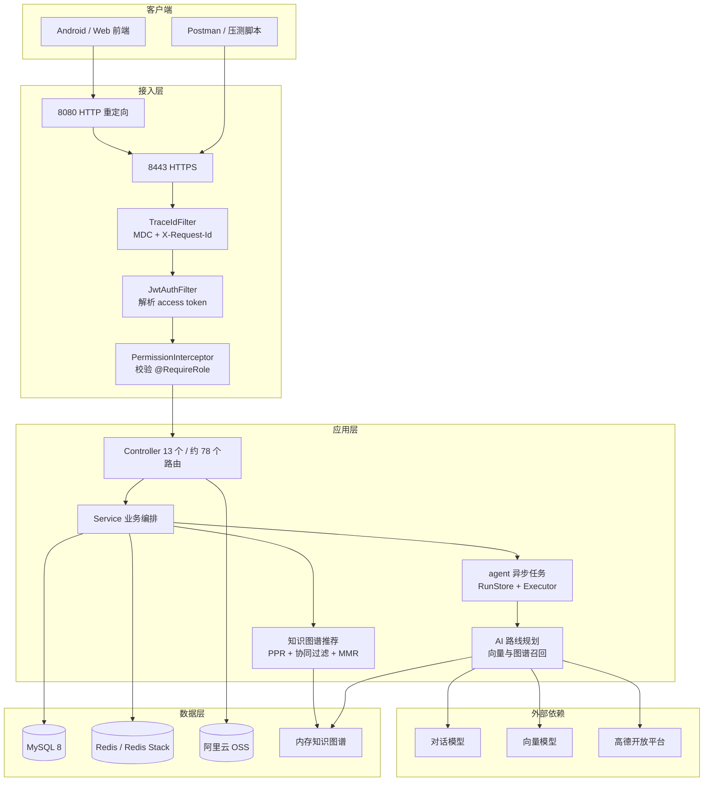
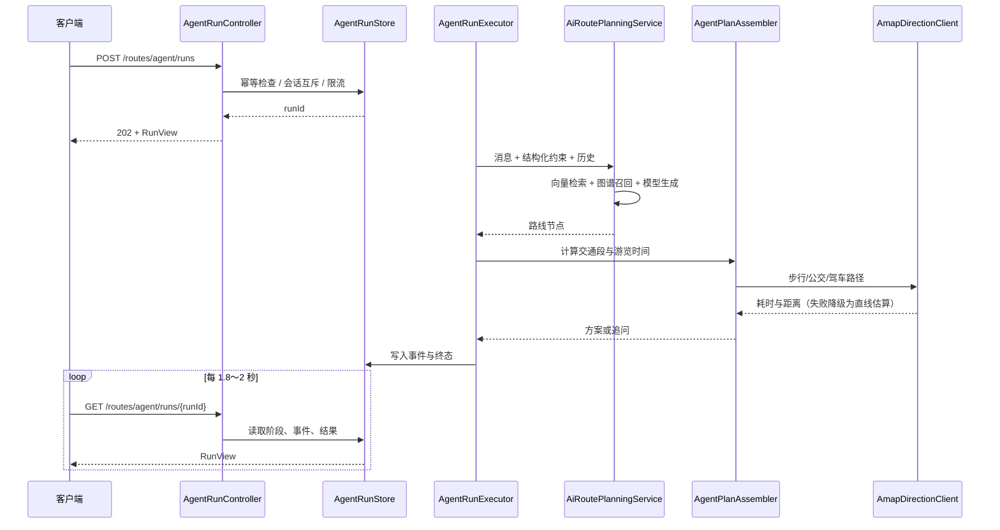
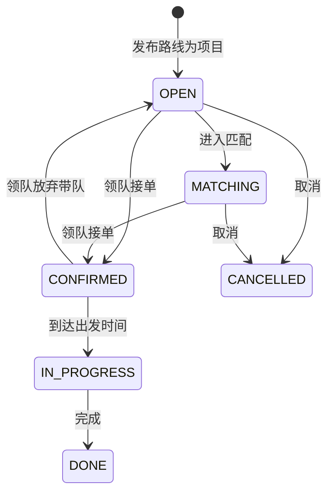

# 系统架构说明

> 更新时间：2026-10-26　适用版本：`0.0.3`　接口字段以根目录 [README.md](../README.md) 为准。

## 1. 定位与边界

本项目是「研学路线规划与组队」平台的后端：用户按兴趣标签获得项目推荐、用自然语言生成或优化研学路线，并以项目为单位完成发布、接单、加入、成团、带队和评价。

系统边界：

- 本仓库只包含后端服务（Spring Boot 单体），前端与 Agent 服务在各自仓库。
- 景点数据、交通耗时、行政区划依赖高德开放平台；对话与向量能力依赖 OpenAI 兼容接口。
- `/routes/agent/runs` 按前端约定返回裸 JSON，不使用统一的 `{code,msg,data}` 包装，属于边界内的特例。

## 2. 技术栈

| 层面 | 选型 | 说明 |
|---|---|---|
| 语言与运行时 | Java 17 | CI 固定 Temurin 17 |
| 框架 | Spring Boot 3.5、Spring Security、Spring WebFlux | WebFlux 仅用于模型流式调用，其余仍为 MVC |
| 持久层 | MyBatis 3 + PageHelper + Druid | SQL 以 XML 为主，便于手写复杂查询 |
| 数据库 | MySQL 8 | InnoDB、utf8mb4；20 张表 |
| 缓存 | Redis | 会话上下文、路线缓存、交通矩阵缓存、限流计数 |
| 向量检索 | Redis Stack（RediSearch）+ LangChain4j | 1536 维，索引名 `study-tour-embedding-index` |
| 模型 | LangChain4j OpenAI 兼容接口 | 对话模型可切 DeepSeek / Ollama；向量模型默认 DashScope |
| 对象存储 | 阿里云 OSS | 头像与图片上传，凭证走环境变量 |
| 数据库迁移 | Flyway | `db/migration` 下 V1 基线 + 增量脚本，启动自动执行 |
| 参数校验 | Jakarta Bean Validation + `@Valid` | 请求 DTO 声明式约束，统一转为 400 |
| 可观测性 | Spring Boot Actuator + MDC traceId | 健康检查、指标、日志链路关联 |
| 接口契约 | springdoc-openapi | `/v3/api-docs` 与 `/swagger-ui.html` 由代码生成 |
| 构建与质量 | Maven、JUnit 5、Mockito、MockMvc、JaCoCo、GitHub Actions | 覆盖率门禁行 39%、分支 31% |

## 3. 部署拓扑

应用以单实例部署在 `47.94.95.110`，`8080` 自动重定向到 `8443`（自签证书，见 `app.https.*`）。单实例假设影响了任务存储与限流的实现，见第 9 节。

## 4. 代码分层

| 包 | 职责 | 备注 |
|---|---|---|
| `controller` | 路由、参数绑定、权限注解 | 不写业务分支，异常交给统一处理器 |
| `service` / `service.impl` | 业务编排、事务边界 | 跨表写操作使用行锁 + CAS |
| `mapper` | MyBatis 接口与 XML | 复杂筛选、分页走 XML |
| `pojo` | 请求/响应/实体载体 | 不做校验以外的逻辑 |
| `agent` | 异步规划任务：任务存储、执行器、方案组装、DTO | 独立的错误体与状态机 |
| `graph` | 内存知识图谱的加载与图查询 | 启动时全量加载，支持 `reload()` |
| `rag` | 景点文档加载、标签分类 | 与向量索引配合 |
| `aiservice` | 路线生成/优化的模型调用 | 提供标准与 Ollama 两套实现 |
| `config` | 安全、拦截器、HTTPS、Redis 向量库 | 通过配置开关控制行为 |
| `interceptor` | 权限与操作日志 | `excludePathPatterns` 只放登录注册 |
| `exception` / `annotation` | 统一异常、角色与操作日志注解 | 三个处理器分别对应普通接口、安全、Agent |
| `utils` | 高德客户端、JWT、OSS、批量数据工具 | `main()` 驱动的数据工具不参与请求链路 |

## 5. 一次普通请求的处理顺序

1. `HttpsRedirectConfig`：`8080` 的请求重定向到 `8443`。
2. `TraceIdFilter`：复用或生成 `X-Request-Id`，写入 MDC 与响应头，日志格式中的 `[traceId]` 即来自这里。
3. `JwtAuthFilter`：校验 `Authorization: Bearer <token>`，把账号 ID 与角色写入 `SecurityContext`；被禁用或角色已变更的账号在这里被拒绝。
4. `PermissionInterceptor`：读取 `@RequireRole`，校验当前角色；未标注的接口只要求登录。
5. `LogInterceptor`：对 `@OperationLog` 标注的方法记录操作日志。
6. Controller：带 `@Valid` 的请求体先经过 Bean Validation，失败直接返回 400，不进入业务层。
7. Service → Mapper。
8. 异常统一转换：`GlobalExceptionHandler`（校验/业务异常/请求体格式）、`SecurityExceptionHandler`（401/403）、`AgentApiExceptionHandler`（Agent 的 422/409/429 裸 JSON）。

响应默认包成 `Result{code,msg,data}`，`code=1` 成功、`code=0` 失败。

## 6. 核心链路 A：异步 AI 路线规划

关键点：

- 创建任务立即返回 `202`，模型与地图查询在 `app.agent.worker-threads` 个后台线程执行，单轮超时 `240s`。
- 同账号 + 同 `requestId` 幂等，同账号 + 同 `memoryId` 会话互斥，单账号 60 秒 6 次、全局 8 个活跃任务的限流都在 `AgentRunStore` 内完成。
- 任务与事件保存在进程内存，30 分钟 TTL；`completed` 只代表执行结束，`result.kind` 才区分「方案」与「追问」。
- 方案不落库，客户端确认后走 `POST /routes/manual` 与发布接口，避免把未确认的 AI 结果写进业务数据。

## 7. 核心链路 B：知识图谱推荐

`KnowledgeGraph` 在启动时把景点、标签、邻近关系、路线、项目、用户偏好、成员与评价加载成内存图，推荐服务只依赖图查询，不直接查库。

首页推荐对每个 `OPEN/MATCHING` 项目打分：

| 维度 | 计算方式 | 权重 |
|---|---|---|
| 地区匹配 | 同区 1.0 / 同市 0.7 / 同省 0.3 | 5 |
| 协同过滤 | 与当前用户标签余弦相似度 Top-20 的用户参与过该项目 | 20 |
| 项目评分 | 评价均分按 5 分制折算 | 10 |
| 图传播 | 项目路线上景点的 Personalized PageRank 均值放大后截断到 1 | 45 |
| 时间衰减 | `1 / (1 + 天数 × 0.01)` | 乘子 |

候选多于 `limit` 时用 MMR（λ=0.7）按路线标签的 Jaccard 相似度做多样性控制；用户没有任何标签偏好时走冷启动，按参与人数与评分排序，未评分的新项目给基础分保证曝光。推荐理由由标签命中、相似用户、评分、同省、相邻景点五类模板生成，无命中时回落到通用文案。

AI 路线候选召回复用同一张图：标签匹配得到种子景点 → 地区优先 → 沿相邻边扩展 2 跳 → 按「同地区 + 标签命中数」排序，缺少经纬度的景点会被剔除。

## 8. 核心链路 C：项目生命周期与并发控制

并发控制手段：

- 接单：`selectByIdForUpdate` 锁行，校验状态与出发时间后写入 `leader_account_id`，`uk_project_leader` 唯一键作为最后一道防线。
- 放弃带队：同一事务内完成行锁 → CAS 改状态与清空领队 → 写 `project_abandon_records` → 移除群聊领队身份；任一步失败整体回滚。
- 加入/退出：`uk_project_member` 保证同一账号不重复加入，`current_members` 按 `represented_count` 汇总。
- 群聊：`chat_sessions` 的 `uk_project_chat` 保证一个项目、一个发布者、一个领队只有一条会话。

## 9. 存储职责

| 存储 | 存放内容 | 失效/一致性 |
|---|---|---|
| MySQL | 账号、项目、路线、景点、评价、群聊、审计记录 | 事务保证；外键约束级联删除 |
| Redis | 登录会话上下文、AI 会话记忆、交通矩阵缓存、向量索引 | TTL 或手动重建；向量索引与 MySQL 非强一致 |
| 内存图谱 | 景点/标签/路线/项目/用户的图结构 | 启动加载；数据变更后需 `reload()` |
| 进程内存 | Agent 任务与事件、限流计数 | 30 分钟 TTL；重启即丢失 |
| OSS | 头像与图片 | 只存 URL，不做删除回收 |

## 10. 关键设计权衡

| 决策 | 选择 | 原因 | 代价 |
|---|---|---|---|
| 推荐算法位置 | 应用内 + 内存图 | 数据规模小，省一次网络跳转，便于调试 | 图全量驻留内存，扩容与一致性受限 |
| Agent 任务存储 | 进程内存 | 单实例部署，实现简单，避免引入消息队列 | 多实例无法共享任务与限流状态 |
| 模型调用方式 | 同步调用 + 超时 + 有限重试 | 链路短，错误处理直接 | 长尾耗时高，需靠限流与排队保护 |
| 事务与状态流转 | 行锁 + CAS + 唯一键 | 防止并发接单/放弃产生半完成状态 | 热点项目存在锁等待 |
| SQL 组织 | MyBatis XML | 复杂筛选与联表更可控 | 字段变更需同时改 XML 与 POJO |
| 接口返回 | 统一 `Result`，Agent 例外 | 前端已有统一拦截器；Agent 契约来自 FastAPI | 两套错误体，需要在文档中明确 |

## 11. 已知边界与演进方向

1. **单实例假设**：Agent 任务、限流计数、内存图谱都在进程内，扩容前需要外置到 Redis 或独立服务。
2. **图谱一致性**：景点/标签变更后不会自动更新内存图，目前依赖重启或手动 `reload()`；可改为定时增量刷新。
3. **数据库迁移**：已接入 Flyway，存量库首次启动自动 baseline 到 V1，后续增量统一放在 `src/main/resources/db/migration`，见 [database.md](./database.md)。
4. **全文检索**：项目/路线搜索使用 `LIKE`，数据量上来后需要全文索引或搜索引擎。
5. **上传校验**：目前只校验文件非空与单文件 1MB，未校验 MIME 类型与图片解码，建议补服务端校验。
6. **可观测性**：已接入 Actuator 健康检查与 MDC traceId；尚未接入 Micrometer 指标上报、告警与集中式日志，多实例部署时 traceId 还需要网关统一注入。

## 12. 工程能力

| 能力 | 实现 | 使用方式 | 开关 |
|---|---|---|---|
| 参数校验 | DTO 上的 `@NotBlank/@Pattern/@Size/@Min` + Controller `@Valid` | 校验失败返回 400 + `{code:0,msg}`，`msg` 为第一个字段提示 | 无 |
| 数据库迁移 | Flyway `classpath:db/migration` | 应用启动时自动执行；存量库自动 baseline，空库从 V1 建表 | `FLYWAY_ENABLED` |
| 健康检查 | Actuator `health` + liveness/readiness | `GET /actuator/health`（无需登录） | 依赖 `management.endpoints.web.exposure` |
| 指标 | Actuator `metrics` | `GET /actuator/metrics`（需登录） | 同上 |
| 日志链路 | `TraceIdFilter` 写 MDC，日志 pattern 输出 `[traceId]` | 请求头 `X-Request-Id` 可透传；响应头返回同一个值 | 无 |
| 接口契约 | springdoc 扫描 Controller 生成 OpenAPI 3 | `/v3/api-docs`、`/swagger-ui.html` | `OPENAPI_ENABLED` |

验证数据（2026-10-27，本机 MySQL 8.0.43 实际启动）：`/actuator/health` 返回 `UP`，`/v3/api-docs` 覆盖全部 Controller，`/actuator/metrics` 未登录返回 401，Flyway 在空库上创建 20 张表并记录 V1/V2 两次成功迁移。
