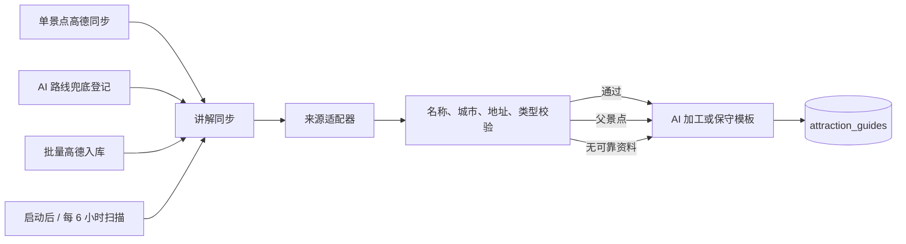

# 景点研学讲解设计

> 更新时间：2026-11-18　适用版本：`0.0.4`　接口字段以根目录 [README.md](../README.md) 为准。

## 1. 目标与边界

景点基础信息由高德 POI 同步，但高德不提供适合研学的景点正文。本功能在 MySQL 中维护独立讲解表，前端按 `poiId` 查询，不在用户请求链路中访问外部百科或调用大模型。

- **有可靠公开资料**：保存通过相关性校验的正文和来源元数据。
- **只有所属景点资料**：明确标记为父景点背景，不冒充当前点位独立介绍。
- **没有可靠资料**：返回高德基础信息和现场观察任务，标记待补录，不编造历史事实。
- **AI 的职责**：根据已经校验的资料生成知识点、思考题和参观建议，不负责发现或编造景点事实。

## 2. 数据模型

### `attraction_guides`

与 `attractions.poi_id` 一一对应，主键即外键，景点删除时级联删除。主要字段：

| 字段 | 说明 |
|---|---|
| `summary` / `content` | 简短介绍、详细讲解 |
| `study_points` / `questions` | JSON 字符串数组，分别对应知识点和思考题 |
| `visit_tips` | 参观建议 |
| `cover_url` / `audio_url` | 媒体地址；图片许可证需要单独核验 |
| `source_name` / `source_url` / `source_type` | 来源名称、规范链接、来源类型 |
| `source_text` | 用于生成和审计的来源快照，不返回前端 |
| `source_revision` | 来源版本，如 MediaWiki 修订号 |
| `source_license` / `source_attribution` | 文字许可证和署名说明 |
| `source_hash` | 景点资料、来源文本和生成模式的哈希，未变化时跳过 |
| `sync_status` | `SOURCED` / `PARENT` / `FALLBACK` |
| `sync_error` | 资料或 AI 降级原因，不返回前端 |
| `auto_update` | `0` 时人工接管，自动任务不覆盖 |
| `synced_at` | 最近一次自动同步时间 |
| `status` | `PUBLISHED` / `DRAFT` |

迁移脚本：

- `V7__create_attraction_guides.sql`：建表。
- `V8__attraction_guides_auto_sync.sql`：来源快照、许可证、哈希、同步状态和自动更新控制字段。

## 3. 来源链

| 顺序 | 来源 | 默认 | 说明 |
|---:|---|---|---|
| 1 | 求闻百科 MediaWiki API | 开启 | 国内可直连，文字 CC BY-SA 4.0，保存标题、正文、URL、修订号 |
| 2 | 中文维基百科 MediaWiki API | 关闭 | 同协议；中国大陆服务器通常不能直连，海外部署可开启 |
| 3 | 百度百科移动页 | 开启 | 只读取 meta 标题、摘要和规范 URL；覆盖小型展馆较好 |
| 4 | 百度百科旧卡片接口 | 关闭 | 需要部署方自有 APPID 和内容授权 |

百度移动页没有可核实的现行开放 SLA，`source_license` 会标注“批量再利用需部署方确认授权”；公开商用前应确认再许可或关闭该来源。

## 4. 同步链路



触发点：

1. `POST /attractions/sync/{poiId}` 在景点落库后立即同步讲解。
2. AI 路线使用请求元数据兜底登记新景点时同步讲解。
3. `AmapAttractionJsonDbSync` 与 `AmapAttractionBatchExporter --syncDb=true` 在批量入库后回填。
4. 应用启动 5 分钟后、之后每 6 小时扫描缺失、景点已变化、来源超过 30 天或前次降级的讲解。
5. ADMIN 可调用增量补录和强制重算接口。

单 POI 使用进程内锁避免定时任务与请求同时刷新同一条记录；来源或模型失败不阻断景点本身同步。

## 5. 防错配规则

只按名称查百科会产生大量同名错配，因此写入前必须同时满足：

- **标题相关性**：规范化标题、二元组相似度、编辑距离或受控副标题匹配。
- **本地证据**：正文必须出现城市、区县、道路或完整地址之一。
- **实体类型**：景点名中的“馆/院/寺/宫/府/陵/园/山/湖/桥/塔/居/碑”等实体词需与词条标题兼容。
- **子 POI**：名称必须与词条标题存在包含关系，禁止用父馆整篇介绍冒充独立纪念碑。
- **地理校验**：MediaWiki 返回坐标时，与高德坐标距离超过 10 km 直接拒绝。
- **行政区排除**：`栖霞区` 不能作为 `栖霞山风景名胜区` 的讲解；`南京市` 不能作为具体景点讲解。
- **通用定义排除**：以“XX是指……”开头的泛化词条不作为具体景点介绍。

查不到或校验失败时，宁可进入 `FALLBACK`，不把疑似内容写为已核验来源。

## 6. AI 加工与降级

配置 `CHAT_MODEL_KEY` 时，模型只接收已经通过校验的来源文本，并要求：

- 不补充资料中没有的历史年代、人物、数据和展品；
- 资料不足时保持简短；
- 父景点资料必须明确说明是所属景点背景；
- 最多输出 6 条知识点和 6 道能依据资料或现场观察完成的思考题；
- 只输出 JSON。

模型超时、HTTP 错误、返回非法 JSON 或没有 Key 时：

- 有百科正文：摘要和正文使用来源文本，知识点/思考题使用保守模板；
- 父景点来源：明确写“所属景点背景”；
- 仅高德资料：`content=null`，只给导览图阅读、现场观察和向工作人员求证类任务。

降级原因写入 `sync_error`，不暴露给前端。

## 7. 查询接口

```http
GET /attractions/{poiId}/guide
```

只查询 MySQL，只返回 `PUBLISHED`。`studyPoints`、`questions` 在数据库中保存 JSON 数组，接口直接返回数组；缺少讲解或仍为 `DRAFT` 时返回 404。内部字段 `source_text`、`source_hash`、`sync_error`、`auto_update` 不返回。

## 8. 运维入口

```http
POST /admin/attraction-guides/backfill?limit=50
POST /admin/attraction-guides/resync?limit=50
```

- `backfill`：只处理缺失、过期或前次降级的数据，供定时任务和日常补录使用。
- `resync`：强制重扫当前有效景点；启用/更换模型 Key 或调整来源规则后使用。人工 `auto_update=0` 的记录仍跳过。

独立回填工具：

```bash
mvn -B -ntp -DskipTests compile exec:java \
  "-Dexec.mainClass=com.viyangle.study_tour.utils.AttractionGuideBackfillTool"

# 只处理单个 POI
mvn -B -ntp -DskipTests compile exec:java \
  "-Dexec.mainClass=com.viyangle.study_tour.utils.AttractionGuideBackfillTool" \
  "-Dexec.args=--poiId=B001905179"
```

## 9. 当前覆盖与已知边界

2026-11-18 部署库 63 个景点：

| 状态 | 数量 | 说明 |
|---|---:|---|
| `SOURCED` | 43 | 求闻 22、百度移动 21 |
| `PARENT` | 4 | 仅有所属景点背景 |
| `FALLBACK` | 16 | 仅高德基础资料 |

剩余降级主要是大型场馆内部的小型纪念碑/雕像、百科尚未收录的新馆，以及百度只有父级词条的展区。它们保留 `FALLBACK`，进入人工补录队列，不以覆盖率换取错误内容。

已知限制：

- 外部百科可能限流、超时或临时不可用；单次失败会降级，后续定时任务可重试。
- 百度移动页是页面解析，不具备正式 API 的稳定性承诺。
- 新启用 AI Key 后需要调用 `resync`，否则已发布内容不会立即重新生成。
