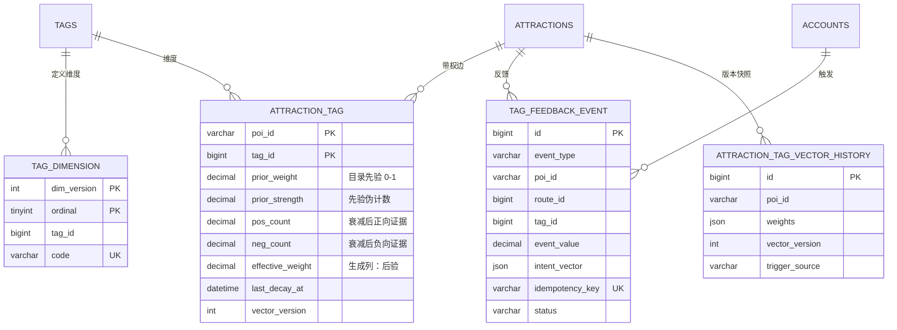

# 景点标签向量化与反馈闭环方案

> 更新时间：2026-10-29　适用版本：`0.0.5`（拟）　状态：第一版已实现（向量只读 + 匹配打分 + 查询接口）
> 关联代码：`graph/KnowledgeGraph`、`rag/`、`service/impl/KnowledgeGraphRecommendServiceImpl`、`service/impl/AiRoutePlanningServiceImpl`、`db/migration/`

## 0. 结论摘要

把景点的「标签集合」升级为 15 维连续向量 `s ∈ [0,1]^15`（15 = `tags.type = 'INTEREST'` 的 15 个研学兴趣标签），并用用户使用过程中的行为反馈持续校准：

```
最终向量 s_i = clamp( (κ_i · p_i + pos_i) / (κ_i + pos_i + neg_i), 0, 1 )
```

一句话：**先验 + 热度，按比例算；用户选得越多，该维越接近 1；负面越多越接近 0；每一维天然被钳在 0~1。**

- **存储**：`attraction_tag` 从 0/1 边升级为「带权边」（稀疏存 15 维向量），新增生成列 `effective_weight` 供 SQL 软筛选用；不引入新中间件。
- **先验 `p`**：现有 `attraction_tag` 标签 + LLM 分级打分 + 1536 维语义锚点投影 + 规则分类器 + 路线共现，按可信度加权；只做初始化，不进入人工审核流程。
- **反馈**：服务端从现有强动作接口直接采集（收藏、发布、加入、退出、评价），前端不新增显式埋点；批量事件接口 `POST /feedback/events` 保留为后续可选增强（曝光、加站/移除、显式纠正）。
- **热度式学习**：正/负证据按时间衰减，后验权重直接作为向量值，0~1 钳位；先验强度 `κ` 决定起步惯性，证据越多越占主导；不需要人工/LLM 审核，靠钳位、衰减、单用户上限和异常自动丢弃约束。
- **兼容**：`routes.tag` / `projects.tag` 的 15 值 ENUM 本期保留，取向量 `argmax` 作为投影；所有旧字段保留，新增 `tagVector`。开关关闭时行为与当前完全一致。路线多标签改造留到后续版本，见 §8.5。
- **排期**：MVP（向量 + 服务端强信号反馈）约 15 人日，完整方案约 22 人日，见 §12。

---

## 1. 现状核对

### 1.1 数据面（`study_tour.sql` 实测）

| 项 | 现状 | 说明 |
|---|---|---|
| 景点 | 65 个，62 个有标签 | — |
| 景点-标签边 | 167 条，均值 2.69 / 景点，范围 1–5 | 现有边全部是 15 个 `INTEREST` 标签，没有 `SCENIC` / `ROUTE_STYLE` 边 |
| 标签字典 | 45 个：`INTEREST` 15、`ROUTE_STYLE` 10、`CROWD` 10、`SCENIC` 10 | `tags.type` 为 ENUM |
| `attractions` 表 | **没有 tag 列** | 标签只存在于 `attraction_tag` 关联表 |
| `routes.tag` / `projects.tag` | 15 值 ENUM，单值 | 项目标签在发布时从路线复制（`ProjectServiceImpl`） |
| 用户偏好 | `account_tag_prefs` 多选，无权重 | 冷启动判断与推荐过滤都用它 |
| 反馈留痕 | 仅 `LogInterceptor` 打印操作日志 | 没有事件表、没有曝光日志，算法无法被评估 |

> 说明：口头上说「景点只有一个 tag」，代码里的实际形态是 **二元多标签**（有/没有），而**路线和项目**才是真正的「15 选 1」。这次升级把两者统一：景点得到 15 维强度，路线/项目得到由站点聚合出的同一套向量，ENUM 字段退化为 `argmax` 投影。

### 1.2 代码面

| 环节 | 现有实现 | 局限 |
|---|---|---|
| 打标 | `StudyTourTagClassifier` 关键词命中；`AttractionTagBatchLabeler` 让 LLM 从 45 个里选 2–5 个 | 没有置信度/强度；关键词是硬命中，同义词不覆盖 |
| 加载 | `KnowledgeGraph` 启动时读成 `Map<poiId, List<tagName>>` | 二元集合，丢失强弱 |
| 召回 | 按标签名取并集 → 地区过滤 → 沿相邻边扩 2 跳（`retrieveCandidatesByGraph`） | 只能命中「被打了该标签」的景点 |
| 排序 | 同地区 +100，每命中一个标签 +50（`calcCandidateScore`） | 命中 1 个与 3 个差距过大；无部分匹配 |
| PPR | 同标签景点边均分权重 0.2（`personalizedPageRank`） | 所有同标签景点等权，跨主题漂移 |
| 多样性 | MMR 用标签集合 Jaccard（`mmrSelect`） | 忽略强度；用 `*100` 硬凑量纲 |
| AI 规划 | `message.contains(tagName)` 精确子串（`AiRoutePlanningServiceImpl`） | 用户说「想看火箭」匹配不到「航天航空」 |
| RAG | 1536 维向量；文档正文写了标签，metadata 没写 `tags` | 与 15 维业务向量是两套坐标，不能混用 |

### 1.3 结构性问题

1. **二值无法表达程度**：南京博物院同时是「历史人文」和「博物馆研学」，现有表示只能都记 1，排序时无法区分「核心主题」和「沾边」。
2. **精确匹配脆弱**：`contains("航天航空")` 要求用户原样说出标签名，自然语言里几乎不可能；「科技探索」和「航天航空」在语义上接近，但集合操作完全无视。
3. **图上的边等权**：PPR 把同标签景点平均分配 0.2，一个「历史人文」标签下有 40 个景点时，随机游走质量被稀释，主题容易漂到「顺路但无关」的景点。
4. **单值枚举无法表达复合路线**：一条「上午博物院 + 下午航天馆」的路线只能被标成 15 选 1，发布成项目后按标签筛选会漏掉一半意图。
5. **没有反馈数据**：所有交互只进日志，既不能调参、不能回滚，也不能回答「改完之后到底好了没有」。
6. **标签质量不可测**：LLM 打标没有置信度，人工也没法在系统里纠正，错误标签会一直存在并污染推荐与 RAG 文档。

---

## 2. 目标与非目标

**目标**

- G1 每个景点有一个 15 维强度向量，可解释、可人工纠正。
- G2 推荐、候选召回、PPR、MMR、AI 规划统一使用向量，取代精确字符串匹配。
- G3 用户行为能改变向量，每维 0~1、可审计、可回滚、可重放。
- G4 对现有接口向后兼容；开关关闭时行为与当前逐字节一致。
- G5 不引入新的中间件，沿用 MySQL + Redis + 内存图谱。

**非目标**

- N1 不替换 1536 维 RAG 向量：15 维负责「业务主题强度」，1536 维负责「语义召回」，两者互补。
- N2 不做深度学习推荐模型；在数据量（62 个有标签景点）下不值得。
- N3 不做实时（秒级）在线训练：事件异步应用，夜间重放为准。
- N4 不解决多实例一致性：当前架构本身就是单实例（见 `architecture.md` §11）。

---

## 3. 向量定义

### 3.1 维度与稳定编码

15 个 `INTEREST` 标签作为固定维度，顺序由数据库表 `tag_dimension` 定义，代码只认 `code`，不认下标：

| ordinal | code | 名称 |
|---:|---|---|
| 1 | `HISTORY_HUMANITIES` | 历史人文 |
| 2 | `MUSEUM_STUDY` | 博物馆研学 |
| 3 | `INTANGIBLE_HERITAGE` | 非遗体验 |
| 4 | `TECH_EXPLORATION` | 科技探索 |
| 5 | `NATURE_ECOLOGY` | 自然生态 |
| 6 | `GEO_GEOLOGY` | 地理地质 |
| 7 | `AEROSPACE` | 航天航空 |
| 8 | `FARMING_LABOR` | 农耕劳动 |
| 9 | `ART_EDUCATION` | 艺术美育 |
| 10 | `RED_EDUCATION` | 红色教育 |
| 11 | `UNIVERSITY_VISIT` | 高校参访 |
| 12 | `CAREER_ENLIGHTENMENT` | 职业启蒙 |
| 13 | `ENGLISH_PRACTICE` | 英语实践 |
| 14 | `PHOTOGRAPHY` | 摄影记录 |
| 15 | `PARENT_CHILD` | 亲子互动 |

`dim_version` 从 1 开始。以后新增维度：新版本 + 新 `ordinal`，旧数据不动，读取端按版本解析；删除维度：`enabled = 0`，从向量中剔除。

### 3.2 数值语义：分级隶属，不是概率分布

`s_i ∈ [0,1]` 表示「该景点对主题 i 的适配强度」，**不要求和为 1**。

这是刻意的选择：如果强制 `Σs_i = 1`，一个同时是「历史人文 0.9」和「红色教育 0.9」的纪念馆就必须二选一，等于把 15 选 1 换成了 15 选 2，没有解决问题。分级隶属允许一个景点在多条主题上都强；「和为 1」只在展示时作为 `share` 视图计算。

对外提供三个视图：

| 视图 | 定义 | 用途 |
|---|---|---|
| `weight` | 原值 `s_i` | 排序、召回、解释 |
| `share` | `s_i / Σs_j` | 前端画「主题构成」、`primaryTag` |
| `primary` | `argmax share` | 兼容 `routes.tag` / `projects.tag` |

`weight` 同时代表「主题适配度」和「用户选择热度」：初始值来自先验，之后由用户行为按 §7 的公式抬高或压低，始终钳在 0~1。前端文案建议用「热门 / 适合」而不是「客观属性」，避免把热度误解成事实。

示例（南京博物院）：

```json
{"weight": [0.78, 0.88, 0.06, 0.04, 0.02, 0.01, 0.01, 0.00, 0.35, 0.12, 0.05, 0.03, 0.02, 0.30, 0.28]}
```

它的 `primary` 是「博物馆研学」，但「历史人文」「艺术美育」「摄影记录」都有可见强度，排序时可以吃到部分匹配。

### 3.3 与旧表示的关系

- 旧二元标签 = 该维 `weight = 1`、其余为 0 的特例，因此**迁移可以无损回填**。
- `ROUTE_STYLE` / `CROWD` / `SCENIC` 三类标签**不进入** 15 维向量，继续以 `attraction_tag` 行存在，作为辅助标签使用。理由：这三类不是互斥的兴趣轴，混进来会让向量维度变成 45 且语义不可比。
- `routes.tag` / `projects.tag` 继续存 15 值 ENUM，但语义改为「站点聚合向量的 argmax」；旧数据不动，读取时若 ENUM 与向量 argmax 不一致，以 ENUM 为准（兼容期）。

---

## 4. 数据模型

### 4.1 存储方案对比

| 方案 | 优点 | 缺点 | 结论 |
|---|---|---|---|
| A. `attractions.tag_vector JSON` | 一行读完，字面「属性」 | 不能 SQL 过滤/排序；JSON TypeHandler；与 `attraction_tag` 二选一，历史与溯源难放 | 否 |
| B. 15 个 `DOUBLE` 列 | 快、可索引 | 维度一改就改表；无法记录来源/置信度 | 否 |
| C. `attraction_tag` 加权重列（稀疏带权边） | 兼容现有表与索引；可 SQL 软筛；每个维度有独立来源/证据；维度增删只加行 | 「向量」是逻辑视图，需加载后组装 | **推荐** |
| D. 新表 `attraction_tag_vector(poi_id, weights JSON)` | 字面向量、单行读写 | 与 `attraction_tag` 重复；丢失逐维证据 | 否 |

选 C：**用带权边存稀疏向量**，用内存和 API 组装成 15 维。这既满足「15 维属性」的表达，又保留了逐维的先验、证据与版本。

### 4.2 目标结构



### 4.3 Flyway V4

> 约定：不改 `V1__baseline.sql`；存量库 baseline 会跳过 V1，因此新表/新列必须放在 V4。V2 已有直接 `ALTER` 的先例，V4 同样接受「只执行一次」的语义。

```sql
-- V4__attraction_tag_vector.sql

-- 1) 维度定义
CREATE TABLE IF NOT EXISTS tag_dimension (
    dim_version  INT          NOT NULL COMMENT '维度版本，维度集合变化时递增',
    ordinal      TINYINT      NOT NULL COMMENT '1..15，向量下标',
    tag_id       BIGINT       NOT NULL COMMENT 'tags.id',
    code         VARCHAR(48)  NOT NULL COMMENT '前后端契约用的稳定编码',
    description  VARCHAR(200) DEFAULT NULL,
    enabled      TINYINT(1)   NOT NULL DEFAULT 1,
    PRIMARY KEY (dim_version, ordinal),
    UNIQUE KEY uk_dim_code (dim_version, code),
    CONSTRAINT fk_dim_tag FOREIGN KEY (tag_id) REFERENCES tags (id)
) ENGINE=InnoDB DEFAULT CHARSET=utf8mb4 COMMENT='标签向量维度定义';

-- 1.1) 空库自包含：补 15 个 INTEREST 标签（存量库已存在，IGNORE 跳过）
INSERT IGNORE INTO tags (name, type) VALUES
('历史人文','INTEREST'), ('博物馆研学','INTEREST'), ('非遗体验','INTEREST'),
('科技探索','INTEREST'), ('自然生态','INTEREST'), ('地理地质','INTEREST'),
('航天航空','INTEREST'), ('农耕劳动','INTEREST'), ('艺术美育','INTEREST'),
('红色教育','INTEREST'), ('高校参访','INTEREST'), ('职业启蒙','INTEREST'),
('英语实践','INTEREST'), ('摄影记录','INTEREST'), ('亲子互动','INTEREST');

INSERT INTO tag_dimension (dim_version, ordinal, tag_id, code)
SELECT 1, d.ordinal, t.id, d.code
FROM (
    SELECT 1 AS ordinal, 'HISTORY_HUMANITIES' AS code, '历史人文' AS name
    UNION ALL SELECT 2,  'MUSEUM_STUDY',          '博物馆研学'
    UNION ALL SELECT 3,  'INTANGIBLE_HERITAGE',   '非遗体验'
    UNION ALL SELECT 4,  'TECH_EXPLORATION',      '科技探索'
    UNION ALL SELECT 5,  'NATURE_ECOLOGY',        '自然生态'
    UNION ALL SELECT 6,  'GEO_GEOLOGY',           '地理地质'
    UNION ALL SELECT 7,  'AEROSPACE',             '航天航空'
    UNION ALL SELECT 8,  'FARMING_LABOR',         '农耕劳动'
    UNION ALL SELECT 9,  'ART_EDUCATION',         '艺术美育'
    UNION ALL SELECT 10, 'RED_EDUCATION',         '红色教育'
    UNION ALL SELECT 11, 'UNIVERSITY_VISIT',      '高校参访'
    UNION ALL SELECT 12, 'CAREER_ENLIGHTENMENT',  '职业启蒙'
    UNION ALL SELECT 13, 'ENGLISH_PRACTICE',      '英语实践'
    UNION ALL SELECT 14, 'PHOTOGRAPHY',           '摄影记录'
    UNION ALL SELECT 15, 'PARENT_CHILD',          '亲子互动'
) d
JOIN tags t ON t.name = d.name AND t.type = 'INTEREST';

-- 2) 带权边：先加普通列
ALTER TABLE attraction_tag
    ADD COLUMN prior_weight    DECIMAL(4,3)  NOT NULL DEFAULT 1.000 COMMENT '目录先验 p，0..1',
    ADD COLUMN prior_strength  DECIMAL(5,2)  NOT NULL DEFAULT 3.00  COMMENT '先验伪计数 κ，越大越难被反馈推翻',
    ADD COLUMN pos_count       DECIMAL(10,3) NOT NULL DEFAULT 0.000 COMMENT '衰减后的正向证据',
    ADD COLUMN neg_count       DECIMAL(10,3) NOT NULL DEFAULT 0.000 COMMENT '衰减后的负向证据',
    ADD COLUMN last_decay_at   DATETIME      DEFAULT NULL,
    ADD COLUMN vector_version  INT           NOT NULL DEFAULT 1,
    ADD COLUMN updated_at      DATETIME      NOT NULL DEFAULT CURRENT_TIMESTAMP ON UPDATE CURRENT_TIMESTAMP;

-- 2.1) 再加生成列与索引（避免同一 ALTER 内引用新列的顺序问题）
ALTER TABLE attraction_tag
    ADD COLUMN effective_weight DECIMAL(4,3) AS (
        CAST(LEAST(1.000, GREATEST(0.000,
            (prior_strength * prior_weight + pos_count)
            / (prior_strength + pos_count + neg_count)
        )) AS DECIMAL(4,3))
    ) STORED COMMENT '生成列：后验权重（0~1），用于 SQL 软筛',
    ADD INDEX idx_attraction_tag_weight (tag_id, effective_weight);

-- 3) 反馈事件（append-only）
CREATE TABLE IF NOT EXISTS tag_feedback_event (
    id               BIGINT       NOT NULL AUTO_INCREMENT,
    account_id       BIGINT       DEFAULT NULL COMMENT 'NULL=匿名/系统',
    session_key      VARCHAR(64)  DEFAULT NULL COMMENT '前端会话，用于归因与去重',
    event_type       VARCHAR(32)  NOT NULL,
    poi_id           VARCHAR(32)  DEFAULT NULL,
    route_id         BIGINT       DEFAULT NULL,
    project_id       BIGINT       DEFAULT NULL,
    tag_id           BIGINT       DEFAULT NULL COMMENT 'TAG_CORRECTION 指定的维度',
    event_value      DECIMAL(8,3) NOT NULL DEFAULT 1.000 COMMENT '带符号的信号强度',
    intent_vector    JSON         DEFAULT NULL COMMENT '事件发生时的意图向量（15 维）',
    context          JSON         DEFAULT NULL COMMENT 'scene/position/client/modelVersion 白名单',
    occurred_at      DATETIME     NOT NULL DEFAULT CURRENT_TIMESTAMP,
    received_at      DATETIME     NOT NULL DEFAULT CURRENT_TIMESTAMP,
    idempotency_key  VARCHAR(80)  NOT NULL,
    status           VARCHAR(16)  NOT NULL DEFAULT 'PENDING' COMMENT 'PENDING/APPLIED/IGNORED/SUSPICIOUS',
    attempts         TINYINT      NOT NULL DEFAULT 0,
    applied_at       DATETIME     DEFAULT NULL,
    apply_note       VARCHAR(200) DEFAULT NULL,
    PRIMARY KEY (id),
    UNIQUE KEY uk_feedback_idem (idempotency_key),
    KEY idx_feedback_poi_time (poi_id, occurred_at),
    KEY idx_feedback_status (status, occurred_at),
    KEY idx_feedback_account (account_id, occurred_at),
    KEY idx_feedback_route (route_id),
    CONSTRAINT fk_feedback_account FOREIGN KEY (account_id) REFERENCES accounts (id) ON DELETE SET NULL
) ENGINE=InnoDB DEFAULT CHARSET=utf8mb4 COMMENT='标签向量反馈事件';

-- 4) 向量快照（重建/人工覆盖/回滚）
CREATE TABLE IF NOT EXISTS attraction_tag_vector_history (
    id                   BIGINT      NOT NULL AUTO_INCREMENT,
    poi_id               VARCHAR(32) NOT NULL,
    dim_version          INT         NOT NULL,
    vector_version       INT         NOT NULL,
    weights              JSON        NOT NULL COMMENT '15 个有效值，按 ordinal',
    priors               JSON        NOT NULL COMMENT '15 个先验值',
    supports             JSON        DEFAULT NULL COMMENT '15 个证据量',
    trigger_source       VARCHAR(24) NOT NULL COMMENT 'REBUILD/FEEDBACK/MANUAL/ROLLBACK',
    operator_account_id  BIGINT      DEFAULT NULL,
    note                 VARCHAR(200) DEFAULT NULL,
    created_at           DATETIME    NOT NULL DEFAULT CURRENT_TIMESTAMP,
    PRIMARY KEY (id),
    KEY idx_vec_history_poi (poi_id, id),
    KEY idx_vec_history_created (created_at)
) ENGINE=InnoDB DEFAULT CHARSET=utf8mb4 COMMENT='景点标签向量快照';
```

### 4.4 回填

V4 的列默认值已经等价完成回填：存量边一律 `prior_weight = 1.000`、`prior_strength = 3.00`，`effective_weight` 由生成列自动算出。人工标签的 `prior_strength = 5.0` 不在 V4 里强改，留给后续 prior 重建任务按 `source = 'MANUAL'` 写入，避免迁移阶段改动业务数据。

```sql
-- 仅作为后续 prior 重建任务的参考，V4 不执行
UPDATE attraction_tag
SET prior_strength = 5.00
WHERE source = 'MANUAL';
```

未出现行的维度视为 `prior_weight = 0`、`prior_strength = 3.0`（弱先验，允许反馈把它抬起来）。这条规则让「新增一维」不需要回填全部景点。

### 4.5 读取与内存结构

```java
// KnowledgeGraph 内新增
private final Map<String, double[]> attractionTagVectors = new ConcurrentHashMap<>(); // poiId -> 15 维有效值
private final Map<String, double[]> attractionTagPriors  = new ConcurrentHashMap<>();
private final Map<String, double[]> attractionTagSupports = new ConcurrentHashMap<>();

double[] getAttractionTagVector(String poiId);   // 缺失返回全 0
double[] getRouteTagVector(Long routeId);        // 按时长加权
double tagSimilarity(String a, String b);        // 余弦
double preferredScore(String poiId, double[] q); // score / match
```

> 第一版把这组状态放在 `TagVectorService` 内，`KnowledgeGraph` 不改；等 PPR/MMR 需要图内邻接时再迁入，避免一开始就动核心图结构。

- 加载：`attraction_tag` join `tag_dimension`（只取 `dim_version = 当前` 且 `enabled = 1`），一次算出 `s_i`，装入 `double[15]`。
- 规模：65 × 15 = 975 个 double；即使 5 万个景点也只有 6 MB 量级，内存图谱完全扛得住。
- 旧视图：`getAttractionTags(poiId)` 继续返回标签名，但只保留 `s_i ≥ 0.5` 的维度（MANUAL/LLM 原有标签基本不变），保证老链路兼容。

### 4.6 为什么不放 Redis / 不建 ANN 索引

15 维向量全量在内存里，一次点积是 15 次乘加；5 万景点全扫也只有 75 万次运算。Redis ANN 索引（以及额外的同步、重建、一致性成本）在这里是负收益。1536 维 RAG 索引继续留在 Redis，两者互不替代。

---

## 5. 先验：向量第一次怎么来

### 5.1 来源与权重

| 来源 | 记号 | 计算 | 默认伪计数 `κ` |
|---|---|---|---|
| 现有人工标签 | `p_man` | 有边 = 1，否则 0 | 5.0 |
| 现有 LLM 标签 | `p_llm0` | 有边 = 1，否则 0 | 3.0 |
| LLM 分级打分（新） | `p_llm` | 0–1 分，见 §5.3 | 3.0 |
| 规则分类器 | `p_rule` | `min(1, ln(1+命中次数)/ln(4))` | 1.5 |
| 语义锚点 | `p_emb` | 余弦映射，见 §5.4 | 2.0 |
| 路线共现 | `p_co` | 条件频率平滑，见 §5.5 | 1.0 |

### 5.2 合成

对每个景点、每个维度，只对「有该来源证据」的项加权平均：

```
p_i = Σ_s κ_s · p_{s,i} / Σ_s κ_s
κ_i = Σ_s κ_s + 1.0          # 无任何来源时：p_i = 0, κ_i = 3.0
```

四个实现细节：

1. **来源缺失就跳过**，不需要给每个景点补齐全部来源。
2. **`p_llm0` 与 `p_llm` 互斥**：重跑 LLM 分级后，把旧二元来源降级为 `κ = 1`，避免同一证据被重复计入。
3. **先验要能说明来源**：`attraction_tag.source` 扩展为 `MANUAL / LLM / LLM_V2 / RULE / EMB / CO`，便于审计。
4. **先验是离线产物**：由 `TagVectorRebuildTool` 或 ADMIN 接口重算，不在请求链路里跑 LLM。

### 5.3 LLM 分级打分（升级 `AttractionTagBatchLabeler`）

现有 labeler 让模型从 45 个标签里选 2–5 个，输出是集合。升级后：

- 只让模型对 15 个 `INTEREST` 维度打分，输出 `0–1` 的两位小数；
- 提示词给每个维度一句判据（避免「亲子互动」和「自然生态」互相污染）；
- 返回 JSON Schema 固定，服务端校验：15 个 key 必须齐全、数值在 `[0,1]`、至多 5 个 `≥ 0.5`；
- 失败重试 1 次，仍失败则跳过并记录，不阻塞整批；
- 每批 10 个景点，`temperature=0.1`，成本可忽略（65 个景点约 7 次调用）。

输出格式：

```json
{
  "B00190BBCZ": {
    "HISTORY_HUMANITIES": 0.72,
    "MUSEUM_STUDY": 0.90,
    "INTANGIBLE_HERITAGE": 0.05,
    "...": 0.0
  }
}
```

落库时按 §5.2 合成，`source='LLM_V2'`，`prior_strength=3.0`；低于 `min-prior-weight`（默认 0.4）的维度不落库，过滤 LLM 的弱相关噪声。

> 实现说明：第一版用 `AttractionTagScorerAi` 调模型，`TagVectorLabelService` 负责超时、解析、校验与落库；失败时回退 `StudyTourTagClassifier.score`（`source='RULE'`，强度 1.5）。新景点由同步链路触发，历史景点由启动补标触发，不依赖人工。

### 5.4 语义锚点投影

给每个维度构造一个 1536 维锚点向量，再用余弦把任意景点投影到 15 维：

1. **锚点文本**：维度名 + 一句判据 + 3 个高置信样例景点（首轮用人工/LLM 标签中该维权重最高的 3 个）。
2. **锚点向量**：`anchor_i = normalize(mean(embed(样例文本)))`，在重建任务里现算，存内存/Redis 即可，**不建表**（15 × 1536 × 4B ≈ 92 KB）。
3. **投影**：`cos_i = cos(emb(attraction), anchor_i)`；校准用线性映射 `p_emb = clip((cos_i − 0.55) / 0.35, 0, 1)`，`cos_i < 0.55` 记 0。
4. **只作为补充来源**：`κ = 2.0`，不覆盖人工/LLM 的强证据。

这一步解决了「语义相近但字面不同」的问题：`科技探索` 与 `航天航空` 的锚点本身在嵌入空间里就接近，博物馆即使没被标「科技」，也会拿到一个不低的 `p_emb`。

### 5.5 规则与共现

- **规则**：保留 `StudyTourTagClassifier` 作为冷启动与兜底，但输出从「标签列表」改为「15 维命中计数」，按 `ln(1+hits)` 压缩长文本带来的次数膨胀。
- **共现**：统计「路线 `tag = T` 且包含景点 A」的条件频率，平滑后作为 `p_co(A, T)`；只对**没有人工/LLM 标签**的景点启用（`κ = 1.0`），避免用行为反过来强化已有标签。
- **防泄漏**：离线评估时，共现先验只能用评估窗口之前的数据计算，否则会自我印证。

### 5.6 冷启动、缺失维度与版本

| 场景 | 处理 |
|---|---|
| 新景点（无标签） | 规则 + 语义锚点给先验；`κ` 低，反馈能快速修正 |
| 新维度（未来扩展） | 新增 `dim_version` 与行；旧景点该维 `p=0, κ=1`，无需回填 |
| 维度下线 | `enabled=0`，读取时剔除，向量长度按版本解释 |
| 全空向量 | 不允许：`primary` 回落到「历史人文」，并在后台任务里标记 `NEEDS_LABEL` |

---

## 6. 反馈：采什么、怎么采

### 6.1 信号清单

「服务端可得」列表示**不需要前端改动**，在现有 Service 里就能采集。

| 事件 | 触发点 | 目标 | 默认权重 | 服务端可得 |
|---|---|---|---:|---|
| `IMPRESSION` | 推荐列表/项目列表曝光（前端批量上报） | 景点/项目 | 0（只做分母） | 否 |
| `ATTRACTION_DETAIL_VIEW` | `GET /attractions/{poiId}` 且停留 ≥ 3s | 景点 | +0.10 | 否 |
| `ROUTE_STOP_CONFIRM` | 最终发布路线上的站点 | 景点 | +0.80 | **是** |
| `ROUTE_STOP_REJECT` | 过程中出现、但未进最终路线 | 景点 | −0.20 | **是** |
| `ROUTE_STOP_NOT_SELECTED` | 候选列表曝光、但从未进路线 | 景点 | −0.02 | **是** |
| `ROUTE_STOP_ADD` | AI 结果页手动「加入路线」（兼容事件） | 景点 | +0.60 | 否 |
| `ROUTE_STOP_REMOVE` | 同上手动移除（兼容事件） | 景点 | −0.60 | 否 |
| `ROUTE_FAVORITE` | `POST /routes/{id}/favorite` | 偏好，不改属性 | +0.50 | **是** |
| `ROUTE_UNFAVORITE` | `DELETE /routes/{id}/favorite` | 偏好，不改属性 | −0.30 | **是** |
| `ROUTE_PUBLISH` | `POST /routes/{id}/publish` | 路线全部站点 | +1.00 | **是** |
| `ROUTE_SAVED` | `POST /routes/manual`、AI 路线保存（仅首次） | 路线全部站点 | +0.40 | **是** |
| `PROJECT_JOIN` | `POST /projects/{id}/join` | 偏好，不改属性 | +1.00 | **是** |
| `PROJECT_QUIT` | `POST /projects/{id}/quit` | 偏好，不改属性 | −0.70 | **是** |
| `PROJECT_PUBLISH` | `POST /projects` | 偏好；最终结算由路线会话处理 | +1.00 | **是** |
| `REVIEW_SCORE` | `POST /reviews` | 偏好，不改属性 | `(score−3)/2 × 0.4` | **是** |
| `THUMBS_UP` / `THUMBS_DOWN` | 景点详情页 | 偏好，不改属性 | ±0.80 | 否 |
| `TAG_CORRECTION` | 「标签不对」面板 | 指定维度 | ±2.00（仅单维） | 否 |
| `TAG_FILTER` | `GET /projects/filter?tag=` | 意图 `q` | 0 | **是** |
| `AGENT_INTEREST` | `POST /routes/agent/runs` 的 `constraints.interests` | 意图 `q` | 0 | **是** |
| `SEARCH_QUERY` | 搜索关键字 | 意图 `q` | 0 | **是** |

设计原则：

- **只采强信号**：浏览/翻页不直接改向量，只做曝光分母，避免「点了就涨」的曝光偏差。
- **强动作优先**：收藏、发布、加入、评价是「付出了成本」的行为，信噪比最高，而且服务端直接可得，是 MVP 的第一批数据。
- **意图与物品分开**：`TAG_FILTER` / `AGENT_INTEREST` / `SEARCH_QUERY` 只更新用户意图向量 `q`，不直接改景点；景点证据来自用户后续的真实动作。
- **纠正单独走**：`TAG_CORRECTION` 是唯一直接改单维的用户事件，权重高但有上限。

### 6.2 事件表与生命周期

```
PENDING --(定时处理器)--> APPLIED
   |                         |
   +--> IGNORED（未知类型/维度/超期/被规则拒绝）
   +--> SUSPICIOUS（流量异常，自动丢弃、不应用）
```

- 事件 append-only，不物理删除；`status` 由处理器推进。
- 每条事件最多重试 3 次，失败保持 `PENDING` 并记录 `attempts`。
- 处理顺序按 `id` 升序；同一 `poi_id` 的事件串行处理，避免并发更新丢失。
- 保留期：`APPLIED` 满 365 天归档到冷表（或直接删除，因为聚合结果已落 `attraction_tag`）。

### 6.3 接口契约

`POST /feedback/events`（需登录；`@OperationLog`）

```json
{
  "sessionKey": "s-7c1e9d",
  "dimVersion": 1,
  "events": [
    {"type": "IMPRESSION", "poiId": "B00190BBCZ", "position": 2, "scene": "RECOMMEND", "idempotencyKey": "e-001"},
    {"type": "ROUTE_STOP_ADD", "poiId": "B00190BBCZ", "scene": "AI_PLAN", "value": 1, "idempotencyKey": "e-002"},
    {"type": "TAG_CORRECTION", "poiId": "B00190BBCZ", "tagCode": "RED_EDUCATION", "value": -1, "idempotencyKey": "e-003"},
    {"type": "THUMBS_UP", "poiId": "B00190BBCZ", "idempotencyKey": "e-004"}
  ]
}
```

约束：

| 项 | 规则 |
|---|---|
| 批量大小 | ≤ 50 条/请求 |
| 请求体 | ≤ 32 KB |
| 频率 | 120 条/分钟/账号（Redis 计数） |
| 幂等 | `idempotencyKey` 唯一，重复返回 `duplicates` |
| 时间 | 服务端 `received_at` 为准；`occurredAt` 只做排序参考，偏差 > 10 分钟截断 |
| 未知 `tagCode` | 忽略并计入 `ignored` |
| 超期事件 | `occurred_at` 早于 7 天：仍入库，`status=IGNORED`，不参与在线更新 |

响应：

```json
{"code":1,"msg":"success","data":{"accepted":3,"duplicates":0,"ignored":1}}
```

`scene`、`position` 等事件级字段由服务端合并进 `context`，`poiId`/`routeId`/`tagCode` 分别落到 `poi_id`/`route_id`/`tag_id`。

### 6.4 前端埋点时机

> 本期（D4）不要求前端新增埋点：先由服务端从现有接口采集强信号。本节是后续增强项，接口契约已经预留，前端接入时不需要再改后端。

| 页面 | 埋点 | 说明 |
|---|---|---|
| 推荐列表 | 卡片进入视口 ≥ 1s 记 `IMPRESSION`（带 position） | 10 条一批上报 |
| 景点详情 | 停留 ≥ 3s 记 `DETAIL_VIEW`；点赞/点踩 | 停留用 `visibilitychange` + 计时 |
| AI 规划结果 | 每次加站/移除站；整条路线保存/收藏/发布 | 加站立刻上报，避免丢失 |
| 景点标签面板 | 展开即展示 15 维强度；「不对」选维度 | 一次最多纠正 3 个维度 |
| 筛选器 | 选/取消标签 → 只更新本地意图，不单独上报 | 意图随下一次事件带 `intentVector` |
| 项目发布/加入 | 服务端自动采集，前端无需重复上报 | 幂等键由服务端生成 |

上报 SDK 建议（前端统一封装，业务代码不直接拼事件）：

```ts
Feedback.track('ROUTE_STOP_ADD', { poiId, scene: 'AI_PLAN' });   // 自动带 sessionKey、dimVersion、幂等键
Feedback.flush();                                                // 页面隐藏/离开时 flush
```

### 6.5 服务端采集点

在现有写操作成功后采集，**必须放在事务提交之后**，且失败不影响主流程：

```java
// 示例：RouteServiceImpl.addFavorite 之后
TransactionSynchronizationManager.registerSynchronization(new TransactionSynchronization() {
    @Override public void afterCommit() {
        feedbackService.recordRouteAction("ROUTE_FAVORITE", routeId, accountId);
    }
});
```

| 类 | 方法 | 事件 |
|---|---|---|
| `RouteServiceImpl` | `addFavorite` / `removeFavorite` | `ROUTE_FAVORITE` / `ROUTE_UNFAVORITE` |
| `RouteServiceImpl` | `saveOptimizedRoute` / `saveOrUpdateAIConversationRoute` | `ROUTE_SAVED`（权重 0.4，仅记录不主导） |
| `ProjectServiceImpl` | `createProject` | `PROJECT_PUBLISH` |
| `ProjectServiceImpl` | `joinProject` / `quitProject` | `PROJECT_JOIN` / `PROJECT_QUIT` |
| `ReviewServiceImpl` | `createReview` | `REVIEW_SCORE` |

注意：`ROUTE_SAVED` 在 AI 规划会话里会反复触发（同一 `memoryId` 多次保存），必须用 `memoryId + routeId` 做幂等，且只对首次保存计权。

### 6.6 幂等、去重、防刷

| 手段 | 规则 |
|---|---|
| 幂等键 | 前端 UUID；服务端动作用「动作:对象:账号:时间片」 |
| 每用户每景点上限 | 30 天内正向证据 ≤ 0.8、负向 ≤ 0.8（按权重折算，超出部分截断） |
| 事件量上限 | 单账号 120 条/分钟；超限丢弃并计数 |
| 异常检测 | 单景点 24h 事件量 > `max(20, 10×中位数)` → 标记 `SUSPICIOUS`，自动丢弃，不进入向量 |
| 新账号 | 注册 < 24h 的账号只能产生 `IMPRESSION` / `DETAIL_VIEW`，`TAG_CORRECTION` 忽略 |
| 位置偏差 | `context.position` 入库；后续用 IPS 加权，MVP 阶段先只做曝光统计 |

### 6.7 隐私

- `context` 只允许白名单键：`scene`、`position`、`client`、`modelVersion`、`sessionKey`；不存原始搜索词和聊天内容。
- `intent_vector` 只存 15 个浮点数，不存来源文本。
- 账号删除：外键 `ON DELETE SET NULL`，事件保留为匿名聚合；如需彻底删除，按 `account_id` 批删。

---

## 7. 学习：反馈怎么改向量

### 7.1 状态与公式

每个 `(poi, dim)` 存四个数：`p`（先验）、`κ`（先验强度）、`pos`、`neg`（衰减后的证据）。

```
w_i = (κ_i · p_i + pos_i) / (κ_i + pos_i + neg_i)          # 后验权重 = 先验与热度的加权平均
s_i = clamp(w_i, 0, 1)                                      # 每维限制在 0~1
```

性质：

- `pos=neg=0` 时 `s=p`，先验完全决定；
- 用户选得越多，`pos` 越大，`s` 越接近 1；负面越多，`s` 越接近 0；
- 分子分母同量纲，**结果天然落在 0~1**，`clamp` 只是兜底；
- 证据按时间衰减（§7.4），老热度会退掉，不会永久占着；
- `κ` 越大（人工标签、强先验）起步越稳；`κ` 越小，反馈越快见效。

默认 `κ`：人工标签 5、LLM 标签 3、规则 1.5、无来源 3。想更「跟用户走」就调小 `κ`；想更稳就调大。**不需要额外设置 ±0.35 的上限**。

### 7.2 信用分配

一个事件往往涉及多个维度，需要把权重分到 15 个维度上：

**单景点事件**（详情、点赞、纠错）：

```
credit_i ∝ (ε + u_i) · s_i        ε = 0.05
```

- `u` 是用户意图向量：来自 `account_tag_prefs` 的 one-hot、当前筛选标签、AI 会话里的 `interests`，三者按 `§7.3` 合成；
- 用户对「红色教育」感兴趣、收藏了一条包含该景点的路线，则这件事主要给「红色教育」加分，而不是给景点已有的「历史人文」加分；
- 用户没有任何偏好/意图时，退化为 `credit_i ∝ s_i`（只强化已有维度，不会凭空造维度）；
- **全零向量的冷启动例外**：`s` 全为 0 时上式无解，改为 `credit_i ∝ u_i`（按意图分配）；`u` 也为 0 时按 15 维均匀分配。否则 3 个没有标签的景点永远收不到反馈，形成死循环。

**路线/项目事件**（收藏路线、加入项目）：对路线上的每个站点分别按上式分配，站点之间按停留时长加权；同一事件只插一行，处理器展开到站点。

**显式纠正**：`credit = 1` 只给指定维度，`value` 带符号；不做多维度分摊。

### 7.3 用户意图向量 `u`

```
u = normalize( α · p_user + β · q_intent + γ · q_recent )
```

| 分量 | 来源 | 默认权重 |
|---|---|---|
| `p_user` | `account_tag_prefs`（one-hot 归一化，可扩展为带权重） | 0.5 |
| `q_intent` | 当前筛选标签 / AI 会话 `interests` / 搜索词分类器输出 | 0.4 |
| `q_recent` | 最近 30 天该账号事件的意图向量衰减和 | 0.1 |

MVP 可以只实现 `p_user + q_intent`，`q_recent` 留到第二阶段；`u` 在 `KnowledgeGraph` 启动时预加载，`/accounts/{id}/tagPrefs` 变更后刷新。

### 7.4 衰减与重放

- **衰减**：`pos *= 2^(−Δt/T_pos)`，`T_pos=90` 天；`neg` 用 `T_neg=180` 天。惰性衰减：每次更新该行时按 `last_decay_at` 折算。
- **在线**：事件 → 异步处理器 → 行更新 + 内存向量热更新，延迟 ≤ 30 秒。
- **离线（权威）**：每天 03:00 从事件日志**从零重放**：按天分桶，逐日应用衰减与证据，重写 `pos/neg` 与 `vector_version`，并写历史快照。在线结果是近似，离线结果可复现。
- **重放一致性**：同一批事件、同一先验版本，重放两次必须得到逐位相同的结果（集成测试覆盖）。

### 7.5 数值示例

南京博物院，先验 `p_red = 0.15`、`κ_red = 3.0`；30 天内 12 个「红色教育」用户收藏了包含它的路线：

| 步骤 | `pos` | `neg` | `s` |
|---|---:|---:|---:|
| 初始 | 0 | 0 | 0.150 |
| 12 次收藏（每次 0.5，credit 0.9） | 5.40 | 0 | **0.696** |
| 再 12 次点踩（每次 0.8，credit 0.9） | 5.40 | 8.64 | 0.343 |
| 180 天无新事件（衰减） | 1.35 | 4.32 | 0.208 |

12 次收藏就能把「红色教育」从 0.15 抬到 0.70，40 次会到 0.88 左右，但永远不会超过 1；一旦点踩变多，又会回落。最后一行展示「证据衰减后向先验回归」：`s` 从 0.343 回到 0.208，继续衰减会回到 0.15，不会永久记住一次差评。

另一个方向：`p_hist=0.80, κ=8`，10 次负向事件（每次 0.8、credit 0.9）会把 `s_hist` 压到约 0.42；强先验能抵抗噪声，但不是不可推翻——负面足够多时仍会降到 0 附近。

### 7.6 不加人工审核，靠什么兜底

反馈直接改权重后，最大的风险是「语义漂移」：历史博物馆被红色教育团体持续选择，红色维一路涨到 0.9。既然不做人工审核，就用五道自动闸门：

| 闸门 | 作用 | 默认 |
|---|---|---|
| 0~1 钳位 | 任何维度不会越界 | 公式内置 |
| 先验强度 `κ` | 起步阶段不容易被少量事件带偏 | 3~5 |
| 时间衰减 | 老热度会退掉，季节/活动带来的偏差自动消退 | 正 90 天 / 负 180 天 |
| 单用户上限 | 同一账号对同一景点 30 天内最多贡献 ±0.8 | 见 §6.6 |
| 异常自动丢弃 | 单景点 24h 事件量超阈值时，新事件只入库、不应用 | 10× 中位数 |

可观测性（是看板，不是审核）：

- 每天重建后输出一张「变化榜」：哪些景点的哪个维度涨/跌最多、由哪些事件导致；
- 单维 7 天变化超过 0.3 时标黄，运营可以看，但不阻塞线上；
- 事件日志 + 快照表保留完整证据，出问题按时间回滚（§10.3）。

即使完全没人盯，也至少保留每日报告和历史快照；数据量上来后，这份报告是排查「为什么这个景点被推给红色用户」的唯一依据。

文案上把 `weight` 叫「热门度 / 适合度」而不是「客观属性」，从产品层面避免误解。

### 7.7 参数

| 参数 | 默认 | 位置 | 说明 |
|---|---:|---|---|
| `prior-strength-default` | 3.0 | `app.tag-vector` | 无来源维度的先验强度 `κ` |
| `prior-strength-manual` | 5.0 | 同上 | 人工标签的 `κ` |
| `prior-strength-llm` | 3.0 | 同上 | LLM / 规则标签的 `κ` |
| `pos-half-life-days` | 90 | 同上 | 正向证据半衰期 |
| `neg-half-life-days` | 180 | 同上 | 负向证据半衰期 |
| `user-cap-30d` | 0.8 | 同上 | 单用户单景点 30 天证据上限，超出部分截断 |
| `intent-weight` | 0.4 | 同上 | 意图向量在信用分配中的权重 |
| `exploration-epsilon` | 0.05 | 同上 | 排序时给低支撑景点的探索加成 |
| `apply-interval` | 30s | 同上 | 事件处理器周期 |
| `suspicious-multiplier` | 10 | 同上 | 异常流量判定倍数 |

### 7.8 什么时候升级模型

当前方案是「Beta 后验 + 0~1 钳位」的热度公式，足够 MVP，也足够可解释。满足以下**任一**条件再考虑逻辑回归/隐语义模型：

- 有效事件 > 5 万条，且有连续 8 周数据；
- 离线 NDCG@10 相对基线提升 < 2%，说明当前的加性模型到顶了；
- 需要做跨用户的个性化排序（同一景点对不同用户展示不同权重）。

升级路径：以当前向量为特征，训练 `LR / LightGBM` 排序模型；或对 `(user, attraction)` 交互做隐语义（ALS），把 15 维作为先验正则项。两者都不改变存储与接口。

### 7.9 探索与回声室

- **排序加成**：`score += ε · sqrt(1 / (support + 1))`，给证据少的景点一点曝光，避免「越没数据越不推、越不推越没数据」。
- **展示兜底**：每个推荐列表至少保留 1 个「低支撑但先验不低」的景点。
- **多样性**：MMR 仍保留，只是相似度从 Jaccard 换成余弦，`λ=0.7` 起步。
- **监控**：每周统计 Top-20 景点的维度熵与曝光覆盖；连续两周下降就降 `ε` 或人工干预。

---

## 8. 服务端改造清单

### 8.1 文件级改动

| 文件 / 类 | 改动 | 风险 |
|---|---|---|
| `pojo/AttractionTag` | 增加 `priorWeight/priorStrength/posCount/negCount/effectiveWeight/vectorVersion/updatedAt` | 低（Lombok，新增字段） |
| `mapper/AttractionTagMapper` + XML | `selectAll` 带新列；后续反馈阶段再加 `upsertEvidence`、`selectByPoiIdForUpdate` | 低 |
| 新增 `pojo/TagDimension`、`mapper/TagDimensionMapper` | 维度元数据（联查 tags.name） | 低 |
| 新增 `pojo/TagFeedbackEvent`、`mapper/TagFeedbackEventMapper` | 反馈阶段实现 | 低 |
| 新增 `service/TagVectorService`、`impl` | 加载、热度权重、`match/score`、对外视图 | 中 |
| 新增 `service/TagVectorLabelService`、`impl` | 自动打分：LLM 优先、规则兜底、补标、单景点重算 | 中 |
| 新增 `aiservice/AttractionTagScorerAi` + `system-attraction-tag-score.txt` | 15 维打分提示词与模型调用 | 低 |
| 新增 `controller/TagVectorAdminController` | `POST /admin/tag-vectors/backfill`、`/{poiId}/relabel` | 低 |
| `service/TagFeedbackService`、`TagFeedbackProcessor`、`FeedbackController` | 反馈事件登记（服务端强动作 + 前端批量接口）、每 30s 应用 pos/neg、衰减与单用户上限 | 中 |
| 新增 `controller/TagController` | `GET /tags/interests` | 低 |
| `controller/AttractionController` | 新增 `GET /attractions/{poiId}`，返回 `tagVector` | 低 |
| `graph/KnowledgeGraph` | 第一版不改结构；向量由 `TagVectorService` 持有，后续 PPR/MMR 需要图内邻接时再迁入 | 中 |
| `service/impl/KnowledgeGraphRecommendServiceImpl` | 候选打分接入向量（`app.tag-vector.enabled` 控制，关闭时走旧逻辑） | **高** |
| `service/impl/AttractionSyncServiceImpl` | 高德同步落库后立即调用自动打分 | 中 |
| `service/impl/AiRoutePlanningServiceImpl` | 意图向量替换 `contains`，候选召回走向量（后续阶段） | **高** |
| `graph/KnowledgeGraphAutoInitializer` | 启动时补标没有 `LLM_V2/RULE` 的景点，并重载图谱 | 中 |
| `rag/AmapAttractionRagDocumentLoader` | 文档正文写分级标签，metadata 写 `tags`（后续阶段） | 低 |
| `utils/AttractionTagBatchLabeler` | 保留旧的二元打标；分级打分由新标签服务负责 | 低 |
| 新增 `utils/TagVectorEvalTool`、`utils/TagVectorMetrics` | 离线 Recall@K / NDCG@K 对比与 CSV | 低 |
| `config/` 新增 `TagVectorConfig` | 反馈阶段的定时任务与参数绑定 | 低 |
| `application.yaml` | `app.tag-vector.*` | 低 |
| `docs/database.md`、`docs/architecture.md`、`README.md` | 同步表与接口 | 低 |

### 8.2 推荐链路

**首页项目推荐**（`recommendProjects`）：

1. 用户向量 `u`（§7.3），冷启动仍按热度；
2. 每个项目算 `routeScore = Σ dur_k · match(u, s_k) / Σ dur_k`；
3. PPR 的个人化种子从「所有偏好标签对应景点」改为 `weight = rel(u, a)`，只保留 `rel > 0.1` 的节点；
4. 总分：`W_REGION·region + W_COLLAB·collab + W_REVIEW·score + W_PPR·ppr`，权重用离线评估重调（现有 5/20/10/45 不变作为基线）；
5. MMR 相似度改为 `cos(s_a, s_b)`，相关度先归一化到 `[0,1]` 再算，去掉 `×100` 的硬编码。

**候选召回**（`retrieveCandidatesByGraph`）：

- 新方法 `retrieveCandidatesByVector(double[] q, String region, int limit)`：
  - 全量打分 `score(q, s_a) = Σ q_i s_i`；65 个景点直接全扫；
  - 规模变大后按 top-2 维度建倒排表，先取候选集再精排；
  - 地区加成、邻居扩展、经纬度过滤保持现有逻辑；
  - 旧方法保留，内部用偏好标签构造 one-hot `q` 调用新方法，行为尽量等价。

> 第一版实现用 `score` 而不是归一化后的 `match` 做候选排序：旧逻辑是「每命中一个标签 +50」，`50·Σ q_i s_i` 在单标签时仍是 +50、双标签时上限 +100，量级不变，同时支持 `s_i` 的部分匹配。`match = score / Σ q_i` 只用于展示和解释。

**推荐理由**：取贡献最大的前两个维度，输出「因为你偏好[历史人文]，该路线包含「南京博物院」（相关度 0.78）」，`attractionTags` 仍返回。

### 8.3 AI 路线规划

- 意图向量：`q = normalize(0.6·classifier(message) + 0.3·map(constraints.interests) + 0.1·p_user)`；分类器沿用 `StudyTourTagClassifier`，但输出改为 15 维计数归一化；精确命中标签名时给该维 +0.5 的强加成（保留现有可解释性）。这里用长期偏好 `p_user` 而不是完整的 `u`，避免与本次意图重复计入。
- 把 `retrieveCandidatesFromGraph` 的「从 message 里找标签名」替换为上面这步，召回走 `retrieveCandidatesByVector`。
- `getCombinedScore` 的「标签匹配度 = 1.0」改为 `match(q, s_a)`；PPR 项先归一化到 `[0,1]`，再按现有的 0.6 / 0.4 融合，避免量纲失衡。
- `AIRoutePlan.tag` 仍由模型给，但校验改为「`tag` 必须是 15 个之一」；如果模型给空，取路线聚合向量的 `argmax` 兜底。

### 8.4 RAG 与语义边

- `AmapAttractionRagDocumentLoader` 正文增加一行：

  ```
  主题权重: 历史人文 0.78; 博物馆研学 0.88; 艺术美育 0.35
  ```

  metadata 补 `tags`（`application.yaml` 的 `metadata-keys` 已声明 `tags`/`tag`，只是当前文档没写值），值用 `code:weight` 逗号拼接，只存 top-5，避免 metadata 膨胀。
- 重索引时机：向量 top-3 维度变化 > 0.1 且距上次重建 > 24h，进入夜间批量；不要每次反馈都调 embedding API。
- 语义边（`THEMATIC`）：新增可选融合 `sim = 0.6·cos(emb) + 0.4·cos(tagvec)`，只对尚未计算语义边的景点生效；已有边不重算。

### 8.5 路线 / 项目兼容

| 场景 | 实现 |
|---|---|
| `routes.tag` 写入 | 保留为最终向量 `argmax` 主标签，兼容旧字段；多标签写入 `route_tag_weight` |
| 路线向量 | 站点景点向量按 `recommendedDuration` 加权平均；模型可选输出 `tagVector`，按 `route-model-weight`（默认 0.3）融合；保存路线时自动重算 |
| `projects.tag` 写入 | 复制路线主标签；项目详情响应额外带 `tagVector` |
| 路线/项目详情响应 | 新增 `tagVector`（路线向量，不返回空的单值语义） |
| `GET /projects` 排序 | 不传 `tags` 时保持 KG 推荐；显式 `tags` + `tagMatch=soft` 时 SQL 按路线向量权重和 + 地区分排序 |
| `GET /projects/filter?tag=` | 默认仍精确匹配 `projects.tag`；`tagMatch=soft` + `minTagWeight` 改为路线向量软筛 |
| 领队看板 `tagNames` | 保留账号偏好标签名 |
| 路线标签接口 | 新增 `GET /routes/{id}/tags` |

> 多标签路线已由 V5 的 `route_tag_weight` 实现：`routes.tag` 只做兼容主标签，真正的主题构成看 `tagVector`。项目列表已支持软筛/软排序（显式 `tags` + `tagMatch=soft`），`projects.tag` 仍复制主标签以兼容旧筛选。

### 8.6 开关

```yaml
app:
  tag-vector:
    enabled: true               # 总开关：false 时全部走旧逻辑；代码回退默认 false
    auto-label-enabled: true    # 新景点/历史景点自动打分
    label-timeout-seconds: 25   # 单次 LLM 等待上限，超时回退规则
    min-prior-weight: 0.4       # 低于该分数的维度不落库，过滤弱相关噪声
    route-model-weight: 0.3     # 模型 tagVector 在路线最终向量中的融合权重
    auto-backfill-enabled: true # 启动时补标没有 LLM_V2/RULE 的景点
    backfill-batch-size: 50     # 每次补标上限
    feedback-enabled: true
    apply-enabled: false        # 默认只采集事件，不自动改景点权重      # 反馈采集与应用
    apply-interval-ms: 30000    # 处理器轮询周期
    apply-batch-size: 100       # 每批事件数
    serve-mode: BLEND           # PRIOR_ONLY / BLEND / LEARNED_ONLY（后续）
    prior-strength-default: 3.0
    prior-strength-manual: 5.0
    prior-strength-llm: 3.0
    pos-half-life-days: 90
    neg-half-life-days: 180
    user-cap-30d: 0.8
    intent-weight: 0.4
    exploration-epsilon: 0.05
    suspicious-multiplier: 10
```

`enabled=false` 时必须能通过「金标测试」：同一批输入的推荐顺序、候选集合、理由文案与改造前完全一致（`KnowledgeGraphRecommendServiceImplTest` 增加对照用例）。

---

## 9. 接口设计

### 9.1 新增 / 变更

| 方法 | 路径 | 权限 | 说明 |
|---|---|---|---|
| `GET` | `/tags/interests` | 登录 | 15 维元数据：`code/name/ordinal/description/dimVersion` |
| `GET` | `/attractions/{poiId}` | 登录 | 景点详情 + `tagVector` |
| `GET` | `/routes` | 登录 | 列表项带 `tagVector`（多标签路线） |
| `GET` | `/routes/{id}/tags` | 登录 | 路线 15 维向量 |
| `GET` | `/projects` | 登录 | `tags` + `tagMatch=soft` 时按路线向量权重和排序；不传保持 KG 推荐 |
| `GET` | `/projects/filter` | 登录 | `tags` + `tagMatch=soft` + `minTagWeight` 多标签软筛/软排序 |
| `GET` | `/projects/{id}` | 登录 | 详情带 `tagVector`（由路线聚合） |
| `POST` | `/feedback/events` | 登录 | 批量反馈，单次 ≤50 条，幂等 |
| `POST` | `/admin/tag-vectors/backfill` | ADMIN | 补标没有 `LLM_V2/RULE` 权重的景点，`limit` 默认 50 |
| `POST` | `/admin/tag-vectors/{poiId}/relabel` | ADMIN | 强制重算单个景点，保留 `MANUAL` |

### 9.2 响应示例

`GET /attractions/B00190BBCZ`

```json
{
  "code": 1,
  "msg": "success",
  "data": {
    "poiId": "B00190BBCZ",
    "name": "南京博物院",
    "adcode": "320102",
    "tagVector": {
      "dimVersion": 1,
      "vectorVersion": 37,
      "updatedAt": "2026-10-28T17:00:00",
      "primary": "MUSEUM_STUDY",
      "primaryName": "博物馆研学",
      "weights": [0.78, 0.88, 0.06, 0.04, 0.02, 0.01, 0.01, 0.00, 0.35, 0.12, 0.05, 0.03, 0.02, 0.30, 0.28],
      "share":   [0.26, 0.30, 0.02, 0.01, 0.01, 0.00, 0.00, 0.00, 0.12, 0.04, 0.02, 0.01, 0.01, 0.10, 0.10],
      "dims": [
        {"code": "MUSEUM_STUDY", "name": "博物馆研学", "weight": 0.88, "prior": 0.90, "support": 12.4},
        {"code": "HISTORY_HUMANITIES", "name": "历史人文", "weight": 0.78, "prior": 0.80, "support": 8.1}
      ]
    }
  }
}
```

- `weights` 按 `dimVersion` 的 `ordinal` 排序，方便前端画雷达图；
- `dims` 只返回 `weight ≥ 0.05` 的维度，避免 15 个全量对象；
- `prior`、`support` 方便前端做「为什么是这个标签」的解释与运营后台排查。

> D2 已定：单层热度式，`weights` 就是反馈调整后的值（0~1），不再拆 `catalog` / `ranking`；`prior`、`support` 仅用于解释和排查。

### 9.3 兼容约定

- 所有旧字段（`tag`、`tagNames`、`tags`）保留；新字段只增不改。
- `weights` 数组顺序由 `GET /tags/interests` 的 `ordinal` 决定，前端不得硬编码顺序。
- `dimVersion` 不匹配时，前端应丢弃本地缓存并重新拉维度表。
- 错误体沿用 `Result{code:0,msg}`；参数校验失败走 400；限流返回 429（新增）。

---

## 10. 迁移与灰度

### 10.1 阶段

| 阶段 | 内容 | 交付物 | 验收 |
|---|---|---|---|
| **P0** 设计冻结 | 维度编码、公式、DDL、开关 | 本文档 + V4 脚本 | 评审通过；`FlywayMigrationTest` 在空库/存量库均通过 |
| **P1** 向量只读 | 带权边加载、先验（现有标签 + 规则）、`tagVector` 接口、`/tags/interests` | 全局向量可查 | 62 个有标签景点向量非空；旧接口响应不变 |
| **P2** 接入排序 | 推荐、AI 规划、PPR、MMR 用向量（flag 控制） | 排序与召回改造 | 金标测试：flag 关 = 旧行为；flag 开离线 NDCG ≥ 基线 |
| **P3** 反馈闭环 | 事件表/接口、服务端强信号采集、处理器、防刷、ADMIN 排查 | 反馈 → 向量可动 | 事件幂等、重放一致、普通事件单维改动 ≤ 0.22 |
| **P4** 评估 + 灰度 | 服务端隐式反馈、离线重放、A/B、RAG 重索引（前端显式埋点可选） | 线上灰度报告 | 主指标提升 + 护栏不退化 |
| **P5**（可选）先验增强 | LLM 分级打分、语义锚点、共现先验 | 先验质量提升 | 人工抽检 Spearman ≥ 0.7 |

### 10.2 灰度顺序

1. 生产库执行 V4，`enabled=false`，观察启动与迁移 1 天；
2. 打开 `serve-mode=PRIOR_ONLY`（只有先验，没有反馈），观察推荐点击与耗时 1 周；
3. 打开 `feedback-enabled=true`，先只采服务端强信号（收藏/发布/加入/评价），观察事件量、异常率；
4. 按账号哈希 10% → 50% → 100% 放量；若后续补前端显式埋点，再单独灰度；
5. 每周跑一次离线重放与人工抽检，连续两周指标稳定后进入常态。

### 10.3 回滚

| 层级 | 手段 |
|---|---|
| 排序 | `app.tag-vector.enabled=false`，立即回到旧逻辑 |
| 反馈 | `feedback-enabled=false`，停止应用，事件仍入库 |
| 数据 | 管理员按快照回滚单景点；全量用 `POST /admin/tag-vectors/rebuild?scope=PRIOR` |
| 表结构 | V4 只加表/列，不回滚；旧代码读不到新列不影响 |

---

## 11. 评估

### 11.1 离线

数据切分：按时间切，用窗口前数据算先验与共现，窗口内新建/收藏的路线做测试集，避免「用未来数据预测过去」。

| 指标 | 定义 | 目标 |
|---|---|---|
| `Recall@10` | 测试路线站点在 Top-10 候选中的命中率 | 相对基线 +5% |
| `NDCG@10` | 以站点为 relevance=1 的排序质量 | 相对基线 +3% |
| `MRR` | 首个命中站点的倒数排名 | 不低于基线 |
| 标签一致性 | 向量 Top-3 与人工标注的一致率 | ≥ 80% |
| 稳定性 | 普通事件单次对单维的改动 | ≤ 0.22（κ≥3 时） |
| 覆盖率 | Top-20 推荐覆盖的景点数 | 不低于基线 |

基线：当前 `calcCandidateScore` + 现有 PPR。评估工具 `TagVectorEvalTool` 从 DB 读数据，输出 CSV 到 `eval_out/tag-vector-*.csv`（目录已存在），结果可回放。

### 11.2 在线

- **分流**：按 `accountId % 100` 分桶，10/90 起步；单量不足时用 2 周前后对比 + 同城/同角色分层。
- **主指标**：推荐卡片 CTR、路线保存率、项目发布率、项目加入率。
- **护栏**：列表 P95 延迟（+≤ 15ms）、零结果率、Top-3 维度熵、景点曝光覆盖、举报率。
- **归因**：事件表带 `modelVersion` / `dimVersion`，可回溯每一次排序用的向量版本。

### 11.3 人工抽检

每周抽 20 个景点 × 2 名评审，按 15 维打分（0/0.5/1），与系统向量算 Spearman；低于 0.6 触发先验重算或单独排查。

---

## 12. 工作量

| 阶段 | 后端 | 前端 | 数据/算法 | 合计（人日） |
|---|---:|---:|---:|---:|
| P0 设计 + DDL | 1 | 0 | 0.5 | 1.5 |
| P1 向量只读 + 接口 | 3 | 0.5 | 0.5 | 4 |
| P2 排序/召回接入 | 3.5 | 0 | 0.5 | 4 |
| P3 反馈闭环 | 4 | 0.5 | 0.5 | 5 |
| P4 评估 + 灰度 | 1.5 | 0.5 | 1.5 | 3.5 |
| P5 先验增强（可选） | 2 | 0 | 2 | 4 |
| **合计** | **15** | **1.5** | **5.5** | **22** |

MVP = P0–P3，约 15 人日（后端 11.5、前端 1、数据 2）；完整方案约 3–4 周（前端显式埋点已按 D4 移出本期）。

### 12.1 关键里程碑

- M1（第 1 周末）：V4 上线，`tagVector` 可查，flag 关闭。
- M2（第 2 周末）：推荐与 AI 规划用向量，离线评估报告出炉。
- M3（第 3 周末）：服务端强信号反馈闭环，事件幂等/重放测试通过。
- M4（第 4 周末）：灰度 10%，A/B 报告；显式埋点若启用则一并观察。

### 12.2 一周版（只验证「向量是否比硬标签好」）

如果不想一上来就做反馈闭环，先做最小验证，约 5 个工作日：

1. V4 只建 `tag_dimension` + `attraction_tag` 的四个权重列（不做事件表、不做快照表）；
2. `TagVectorService` 从现有 167 条标签生成先验（等于带 0.85/0.7 权重的 one-hot）+ 规则补充，不接 LLM、不接 embedding；
3. `TagVectorService` 加载向量，把 `calcCandidateScore` 的「每命中 +50」换成 `+50·Σ q_i s_i`，其余逻辑不动；
4. 用 `TagVectorEvalTool` 在历史路线上跑 NDCG@10 / Recall@10，与当前基线对比。

达标（+3% 以上）再进入 P3 反馈闭环；不达标先查先验质量，不要急着加反馈。这条路径把「算法假设验证」和「系统工程」分开，失败成本最低。

### 12.3 第一版已落地（2026-10-29）

| 项 | 实现 |
|---|---|
| 迁移 | `V4__attraction_tag_vector.sql`：`tag_dimension`、`attraction_tag` 权重列与 `effective_weight` 生成列、反馈事件表、向量快照表 |
| 向量加载 | `TagVectorService` / `TagVectorServiceImpl`：读维度与带权边，按 `(κ·p+pos)/(κ+pos+neg)` 计算，0~1 钳位 |
| 自动打分 | `TagVectorLabelService` / `TagVectorLabelServiceImpl` + `AttractionTagScorerAi`：LLM 优先、超时/失败回退 `StudyTourTagClassifier.score` 规则；新景点同步保留 `MANUAL`，后台补标/管理员重算为强制重算，可覆盖存量 `MANUAL` 种子 |
| 触发链路 | 新高德景点：`AttractionSyncServiceImpl.syncFromAmap` 落库后立即打分；历史/脚本数据：`KnowledgeGraphAutoInitializer` 启动后分批补标；ADMIN 可手动 `POST /admin/tag-vectors/backfill` 或 `/{poiId}/relabel` |
| 反馈闭环 | `TagFeedbackService` + `TagFeedbackProcessor` + `FeedbackController`：`POST /feedback/events` 接收前端事件；属性证据只包括显式纠正、最终确认/拒绝、路线保存/发布；点赞点踩/收藏/加入项目/评价只记偏好，返回 `preference-only`，不改景点 tag |
| 路线迭代 | `RouteIterationFeedbackService` 按 `accountId + memoryId` 记录过程出现过/曝光过的景点；**中间轮次不加减分**，项目发布时结算：最终路线 `ROUTE_STOP_CONFIRM +0.8`，过程出现但未进最终路线 `ROUTE_STOP_REJECT -0.2`，仅曝光未选 `ROUTE_STOP_NOT_SELECTED -0.02` |
| 多标签路线 | V5 `route_tag_weight(route_id, tag_id, weight)`；模型输出可选 `tagVector`，按 `route-model-weight` 与站点时长加权向量融合；保存路线自动重算，`routes.tag` 回写 argmax 兼容；`GET /routes/{id}/tags`、路线列表 `tagVector`、项目详情 `tagVector` |
| PPR/MMR | `KnowledgeGraph.personalizedPageRank` 支持种子权重与向量同标签边；`KnowledgeGraphRecommendServiceImpl` 用向量给 PPR 种子加权、MMR 用项目站点平均向量的余弦相似度；AI 规划的 PPR 同样按意图匹配度加权 |
| 查询接口 | `GET /tags/interests`、`GET /attractions/{poiId}`、`GET /routes/{id}/tags`（响应带 `tagVector`） |
| 打分接入 | `KnowledgeGraphRecommendServiceImpl.retrieveCandidatesByGraph`：`+50·Σ q_i s_i`，由 `app.tag-vector.enabled` 控制；关闭时逐字节保持旧逻辑 |
| 离线评估 | `TagVectorEvalTool` + `TagVectorMetrics`：用历史路线站点做 relevance，输出 Recall@10 / NDCG@10 对比 CSV 到 `eval_out/` |
| 配置 | `app.tag-vector.enabled=true`（application.yaml；代码回退默认 false）；自动打分、反馈相关见 §8.6 |
| 测试 | 343 个用例通过，JaCoCo 行 46.9% / 分支 39.1%，门禁通过；`FlywayMigrationTest` 在空库与存量库均通过 |

本地端到端验证（MySQL 8，62 个景点、167 条边）：`/tags/interests` 返回 15 维；自动打分先用规则把 50 个 ACTIVE 景点重算为 `RULE`，再用真实模型跑 LLM 分级，50/50 成功，最终 `attraction_tag` 为 188 条 `LLM_V2`（仅保留 ≥0.4 的维度）+ 37 条 `MANUAL`（12 个 `STALE` 景点）；`/attractions/B00190513A` 返回分级后的 `tagVector`，列表接口不返回该字段。另插入临时景点验证单景点自动打分，再用临时景点验证反馈：`TAG_CORRECTION` 写入 `pos=2`、`effective=0.4`，重复键被幂等拦截。多标签路线用一条临时 manual 路线（国防园 + 科技馆）验证：`route_tag_weight` 写入 6 个维度，历史人文 0.82、科技探索 0.78、红色教育 0.34，`routes.tag` 回写为「历史人文」，`GET /routes/{id}/tags` 同步返回；测试数据均已删除。

**当前边界**

- 50 个 ACTIVE 景点已用真实模型分级，每个保留 3–10 个 ≥0.4 的维度；12 个 `STALE` 景点保留 `MANUAL`，没有自动权重；
- 自动打分是同步调用（单景点），LLM 超时会回退规则，最坏多等 25 秒；批量补标在后台线程，不阻塞启动；
- PPR（推荐与 AI 规划）和 MMR 已接向量；AI 规划的意图提取仍用 `message.contains` 匹配标签名，候选召回打分已向量化；
- 反馈闭环已接入：显式 `TAG_CORRECTION` 和最终发布结算会更新景点 tag；点赞点踩/收藏/加入项目/评价只记偏好，不改变属性权重。路线会话目前在内存中（按 `accountId + memoryId`），应用重启会丢失未发布的会话；5 折交叉验证显示最终结算的平均 NDCG@5 仍下降 0.0099（95% CI 跨 0），当前 `apply-enabled=false`，只采集不应用；
- 离线评估（297 条路线、K=10）：原始二元基线 Recall 0.2332 / NDCG 0.1515；LLM 分级（≥0.4）的精确标签基线 0.2424 / 0.1586，向量 0.2292 / 0.1472；向量在「路线站点」口径下仍低于精确基线。语义抽检合理（国防园红色 0.85、美术馆艺术 0.95、朝天宫历史 0.95、玄武湖自然 0.75），差距更可能来自评估口径偏严格、数据规模小，而不是标签完全不可用。代码回退默认 `enabled=false`，当前 `application.yaml` 已设为 `true`；建议先做在线小流量对比或补标签一致性评估。

---

## 13. 风险与开放问题

### 13.1 风险

| 风险 | 影响 | 概率 | 应对 |
|---|---|---|---|
| 数据太少（62 个有标签景点）导致过拟合 | 高 | 高 | 先验强一点（`κ` 3~5）+ 时间衰减 + 离线评估；只有强动作才计权 |
| 热度漂移：历史博物馆被红色团体刷成红色 0.9 | 高 | 中 | 0~1 钳位 + 单用户上限 + 衰减 + 每日变化榜标黄 + 快照回滚；文案用「热门度/适合度」而非「客观属性」 |
| 曝光/位置偏差 | 中 | 高 | MVP 只采强动作；记录 `position`；后续 IPS |
| 现有测试被破坏 / 覆盖率跌破门槛 | 中 | 中 | flag 默认关闭 + 金标对照测试 + 新增单测；CI 门禁行 39%/分支 31% |
| Flyway 在存量库失败 | 高 | 低 | V4 独立建表/加列；本地先跑 `FlywayMigrationTest`；准备手工回滚 SQL |
| 内存图谱与 DB 不一致 | 中 | 中 | 单实例 + 处理器热更新 + 夜间全量重放校准 |
| RAG 重索引成本 | 低 | 低 | 夜间批量 + 变化阈值，不做实时重嵌 |
| 反馈被刷 | 中 | 中 | 幂等、单用户上限、新账号限制、异常自动丢弃、快照回滚 |
| 维度语义重叠（科技 vs 航天） | 中 | 中 | 锚点 + 规则 + 人工抽检；允许一景点多强维度 |

### 13.2 决策记录

| # | 问题 | 结论 | 影响 / 备注 |
|---|---|---|---|
| D1 | 15 维是否只取 `INTEREST`？ | **已定：只取 15** | `ROUTE_STYLE` / `CROWD` / `SCENIC` 继续作为辅助标签，不进向量 |
| D2 | 反馈是否要人工 / LLM 审核？ | **已定：不审核**，单层热度公式，反馈直接改权重，0~1 钳位 | 标签会随用户漂移，靠文案、看板和回滚控制，见 §13.3 |
| D3 | `routes.tag` / `projects.tag` 是否改多标签？ | **已定：后续改**；本期保留 ENUM + `tagVector` | 后续用 V5 引入 `route_tag` / `routes.tag_vector`，景点侧无需改动，见 §8.5 |
| D4 | 前端本期是否接曝光 + 显式反馈？ | **已定：不新增显式埋点**，只从现有接口采服务端强信号 | 曝光/点击类信号缺失，P4 前端工作减少；后续可平滑加回 |
| D5 | 是否允许夜间重建任务与 ADMIN 接口？ | 推荐允许 | 决定运维复杂度 |
| D6 | 是否回填历史行为（约 5496 条成员、735 条收藏、243 条评价）作为初始证据？ | 先 dry-run，权重减半 | 能显著加快冷启动，但含演示数据 |

### 13.3 热度式反馈：为什么可以不加审核

导师的想法是「用户选得多，某方面就涨」，本质是一个**带先验的热度公式**，不需要人工判断对错：

```
s_i = clamp( (κ_i·p_i + pos_i) / (κ_i + pos_i + neg_i), 0, 1 )
```

- `p_i`：初始值（现有标签 / LLM / 规则），只决定起点；
- `pos_i` / `neg_i`：用户选择的正 / 负证据，按时间衰减；
- `κ_i`：先验强度，决定起步惯性；
- 分母是总证据量，所以结果一定在 0~1，且证据越多越接近「实际选择比例」。

**为什么可以不加审核**

- 每一维独立计算：涨的是被用户选择的那一维，其他维不动，不会互相挤占；
- 单用户上限 + 时间衰减 + 异常自动丢弃，能把刷量压到可接受范围；
- 0~1 钳位保证不会溢出；
- 事件日志 + 每日快照保证可回滚。

**代价（必须知道）**

- 标签会「随用户漂移」：历史博物馆如果长期被红色教育团体选择，红色维会真的涨上去；
- 这是热度的定义，不是 bug；如果不想让它发生，只能加人工/LLM 复核，或者把展示文案改成「热门度 / 适合度」；
- 建议 UI 上不要写「景点属性：红色教育」，而是「红色教育用户也常选」。

**本期的一个现实问题：负向信号很少**

前端不做显式点踩，负向只能来自「退出项目、取消收藏、低分评价」，量比正向少得多。结果就是热度更容易涨、不容易跌。缓解办法：

- `T_neg=180` 天比 `T_pos=90` 天长，让一次负面影响留得更久；
- 单用户上限和 `κ` 控制单次涨幅；
- 如果上线后发现「只涨不跌」，再加一个「不感兴趣」按钮（复用 `POST /feedback/events`，不用改后端）。

**数值直觉**

- `κ=3, p=0.15`：12 次收藏（每次 0.45）→ 0.70；40 次 → 0.88；之后再来 12 次点踩（每次 0.72）→ 0.34；180 天不活跃 → 回落到 0.21；
- `κ=8, p=0.8`：10 次负向只压到 0.42，强先验更抗噪。

**如果以后想收紧**

- 调大 `κ`：反馈变慢、先验更稳；
- 调小 `user-cap-30d`：单用户影响更小；
- 缩短 `T_pos`：热度退得更快；
- 这些都在配置里，不用改代码。

---

## 附录 A：维度编码与判据

| code | 名称 | 判据（给 LLM 的提示词摘要） |
|---|---|---|
| `HISTORY_HUMANITIES` | 历史人文 | 历史事件、古建、故居、遗址、传统文化载体 |
| `MUSEUM_STUDY` | 博物馆研学 | 博物馆、博物院、陈列馆、展馆，以展陈学习为主 |
| `INTANGIBLE_HERITAGE` | 非遗体验 | 传统技艺、手作、民俗、非遗工坊 |
| `TECH_EXPLORATION` | 科技探索 | 科技馆、科普实验、自然科学互动 |
| `NATURE_ECOLOGY` | 自然生态 | 湿地、动植物、生态公园、自然观察 |
| `GEO_GEOLOGY` | 地理地质 | 地貌、岩石、矿物、地质构造 |
| `AEROSPACE` | 航天航空 | 航空/航天器、飞行、火箭、卫星、空军 |
| `FARMING_LABOR` | 农耕劳动 | 农田、农事体验、劳动教育 |
| `ART_EDUCATION` | 艺术美育 | 美术、音乐、戏剧、书法、设计 |
| `RED_EDUCATION` | 红色教育 | 革命史、烈士、抗战、国防教育 |
| `UNIVERSITY_VISIT` | 高校参访 | 大学校园、校史馆、实验室开放 |
| `CAREER_ENLIGHTENMENT` | 职业启蒙 | 工厂、企业、行业实践、职业体验 |
| `ENGLISH_PRACTICE` | 英语实践 | 外语场景、国际交流、双语导览 |
| `PHOTOGRAPHY` | 摄影记录 | 取景、风光、地标、建筑摄影 |
| `PARENT_CHILD` | 亲子互动 | 亲子设施、儿童体验、低龄友好 |

## 附录 B：默认参数速查

| 符号 | 值 | 含义 |
|---|---:|---|
| `DIM` | 15 | 维度数 |
| `κ_default` | 3.0 | 无来源维度的先验强度 |
| `κ_manual` | 5.0 | 人工标签先验强度 |
| `κ_llm` | 3.0 | 旧 LLM 标签 |
| `κ_llm_v2` | 3.0 | 新 LLM 分级 |
| `κ_rule` | 1.5 | 规则 |
| `κ_emb` | 2.0 | 语义锚点 |
| `κ_co` | 1.0 | 共现 |
| `T_pos` | 90 天 | 正向半衰期 |
| `T_neg` | 180 天 | 负向半衰期 |
| `user_cap_30d` | 0.8 | 单用户单景点 30 天证据上限 |
| `ε` | 0.05 | 信用分配平滑 |
| `ε_explore` | 0.05 | 探索加成 |
| `λ_MMR` | 0.7 | 多样性权重 |

## 附录 C：核心伪代码

```java
public final class TagVectorMath {

    public static double[] prior(List<Source> sources, int dim) {
        double[] p = new double[dim];
        for (int i = 0; i < dim; i++) {
            double weighted = 0, total = 0;
            for (Source s : sources) {
                if (s.has(i)) { weighted += s.kappa() * s.weight(i); total += s.kappa(); }
            }
            p[i] = total == 0 ? 0.0 : weighted / total;
        }
        return p;
    }

    public static double heat(double prior, double kappa, double pos, double neg) {
        double w = (kappa * prior + pos) / (kappa + pos + neg);
        return clamp(w, 0.0, 1.0);              // 每维限制在 0~1
    }

    public static double[] credit(double[] vector, double[] intent, double eps, int dim) {
        double[] c = new double[dim];
        double sum = 0;
        for (int i = 0; i < dim; i++) {
            c[i] = (eps + intent[i]) * vector[i];
            sum += c[i];
        }
        if (sum <= 1e-9) {                      // 冷启动：向量全零时按意图分配
            for (int i = 0; i < dim; i++) { c[i] = intent[i]; sum += c[i]; }
        }
        if (sum <= 1e-9) {                      // 意图也为零：均匀分配
            java.util.Arrays.fill(c, 1.0 / dim);
            return c;
        }
        for (int i = 0; i < dim; i++) c[i] /= sum;
        return c;
    }

    public static double decay(double count, long days, double halfLifeDays) {
        return count * Math.pow(0.5, (double) days / halfLifeDays);
    }

    private static double clamp(double v, double lo, double hi) {
        return Math.max(lo, Math.min(hi, v));
    }
}
```

```java
// 事件应用（单条）
@Transactional
public void apply(TagFeedbackEvent event) {
    double[] intent = resolveIntent(event);                 // §7.3
    List<String> stops = resolveStops(event);               // poi / route / project
    for (String poiId : stops) {
        double[] vector = cache.get(poiId);                 // 当前有效值
        double[] credit = TagVectorMath.credit(vector, intent, EPS, DIM);
        for (int i = 0; i < DIM; i++) {
            if (credit[i] == 0) continue;
            double delta = event.value() * credit[i];
            AttractionTagRow row = loadOrInit(poiId, i);    // 缺行 → p=0, κ=κ_default
            decay(row, now());
            if (delta >= 0) row.pos += delta; else row.neg += -delta;
            row.vectorVersion++;
            save(row);
        }
        cache.put(poiId, rebuildVector(poiId));
    }
    markApplied(event);
}
```

```java
// 重放（夜间，权威）
public void rebuild(long fromEpochDay, long toEpochDay) {
    Map<String, double[]> counts = loadCurrentCounts();     // 已衰减到 fromEpochDay
    for (long day = fromEpochDay; day <= toEpochDay; day++) {
        counts.replaceAll((poi, c) -> decayTo(c, day));
        for (TagFeedbackEvent e : loadEventsOfDay(day, APPLIED)) {
            applyToCounts(counts, e);                        // 与在线同一套信用分配
        }
    }
    writeCounts(counts);                                     // 覆盖 pos/neg，写快照
    graph.reloadTagVectors();
}
```

---

## 附录 D：与现有文档的关系

- `architecture.md` §7「知识图谱推荐」：改造后补充「向量」维度的说明；
- `database.md` §3 表清单：增加 `tag_dimension`、`tag_feedback_event`、`attraction_tag_vector_history`，并说明 `attraction_tag` 的权重语义；
- 根 `README.md`：新增接口按「统一返回 `Result`」的格式补文档，`/feedback/events` 单独说明限流与幂等；
- 本文档随实现进展更新「阶段」与「验收」两节，完成后转为「设计记录」。
