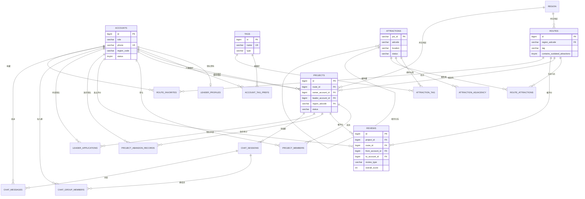

# 数据库设计说明

> 更新时间：2026-10-26　适用版本：`0.0.3`　以 `scripts/full_schema.sql` 为准。

## 1. 概况

- 数据库：MySQL 8，InnoDB，`utf8mb4` / `utf8mb4_0900_ai_ci`。
- 规模：20 张表、47 个二级索引，主键以自增 `bigint` 为主，景点相关表用高德 `poi_id`（`varchar(32)`）作主键。
- 设计取向：核心业务（账号、项目、路线、评价）保持强约束与级联；推荐与知识图谱相关的表（`attraction_tag`、`attraction_adjacency`、`reference_pairs`）以「可批量重建」为目标，允许由脚本重新灌入。
- 完整的建库/示例数据脚本是 `scripts/full_schema.sql`（由 mysqldump 导出，包含演示数据）；存量库使用 `scripts/` 下的增量脚本，见第 5 节。

## 2. ER 图

## 3. 表清单

| 表 | 中文名 | 职责 | 关键约束 |
|---|---|---|---|
| `accounts` | 账号 | 登录主体，区分 `USER/LEADER/BOTH/ADMIN` 四种角色，`status` 控制启用禁用 | 主键 `id`；`phone` 唯一 |
| `leader_profiles` | 领队资料 | 与账号 1:1，存领队简介与评分汇总 | 主键 `account_id`，外键指向 `accounts` |
| `leader_applications` | 领队申请 | 领队申请某个项目带队，状态 `PENDING/ACCEPTED/REJECTED/CANCELLED` | 外键指向 `projects`、`accounts` |
| `tags` | 研学标签 | 45 个标签，分 `INTEREST/ROUTE_STYLE/CROWD/SCENIC` 四类 | 主键 `id`；`name` 唯一 |
| `account_tag_prefs` | 用户标签偏好 | 用户兴趣画像，推荐与 AI 规划的用户上下文 | 联合主键 `(account_id, tag_id)` |
| `region` | 行政区划 | 省/市/区三级 `adcode`，支持虚拟节点 | 主键 `adcode`；`parent_adcode` 自关联 |
| `attractions` | 景点 | 高德 POI 字段 + 业务字段（`status` 标记失效景点） | 主键 `poi_id`；`uk_attractions_poi_id` |
| `attraction_tag` | 景点-标签 | 知识图谱「景点→标签」边，来源 `LLM/MANUAL` | 联合主键 `(poi_id, tag_id)` |
| `attraction_adjacency` | 景点相邻 | 地理邻近（`GEOGRAPHIC`）与语义相似（`THEMATIC`）两类边，带通勤时间与距离 | 联合主键 `(from_poi_id, to_poi_id, relation_type)` |
| `reference_pairs` | 参考景点对 | 按标签/地区沉淀的「可串联景点对」及说明，供路线生成参考 | 主键 `id`；`poi_id` 不作强外键，可批量重建 |
| `routes` | 路线 | 一条可发布的行程，记录地区、标签与是否含失效景点 | 外键指向 `region` |
| `route_attractions` | 路线节点 | 路线与景点的有序关联，含游览时间、建议时长、交通说明 | 联合主键 `(route_id, visit_order)` |
| `route_favorites` | 路线收藏 | 账号收藏路线 | 联合主键 `(account_id, route_id)`，级联删除 |
| `projects` | 项目 | 由路线发布出的组队活动，含发布者、领队、出发信息与状态 | 外键指向 `routes`、`accounts`、`region` |
| `project_members` | 项目成员 | 参与关系与代表人数，驱动 `current_members` | 唯一键 `uk_project_member(project_id, account_id)` |
| `project_abandon_records` | 放弃带队记录 | 领队放弃的审计：原因、放弃前状态、出发时间快照 | 外键指向 `projects`、`accounts`，级联删除 |
| `reviews` | 评价 | `USER_TO_LEADER` / `LEADER_TO_USER` / `ROUTE_ONLY` 三类评价 | 外键指向 `projects`、`routes`、`accounts` |
| `chat_sessions` | 项目群会话 | 一个项目对应一个群，记录发布者与领队 | 唯一键 `uk_project_chat(project_id, user_account_id, leader_account_id)` |
| `chat_group_members` | 群成员 | 群内角色 `USER/LEADER/SYSTEM`，记录加入/离开时间 | 联合主键 `(session_id, account_id)` |
| `chat_messages` | 群消息 | 文本/图片/系统消息 | 外键指向 `chat_sessions`、`accounts` |

## 4. 关键约束与索引

- 账号：`phone` 唯一，注册与登录都以手机号为业务标识；`role` 为 ENUM，新增角色必须同时改代码与表结构。
- 项目：`uk_project_leader(project_id, leader_account_id)` 防止同一领队重复接单；`project_members` 的唯一键防止重复加入；两者是接单/加入并发控制的最后一道防线。
- 路线节点：`(route_id, visit_order)` 联合主键保证站序不重复，调整顺序需要先删除后插入。
- 群聊：`uk_project_chat` 包含可空的 `leader_account_id`，MySQL 唯一索引允许多个 NULL，因此「项目没有领队」时可能产生多条候选会话，业务侧以 `project_id` 查询为准。
- 外键：业务表统一使用 `ON DELETE CASCADE` 或 `SET NULL`；`region_adcode` 使用 `SET NULL`，避免行政区划调整导致项目删除。
- 索引：外键列与高频筛选列（`status`、`departure_date`、`poi_id`、`account_id`）均有二级索引；推荐链路不直接查库，索引主要服务管理端与数据同步脚本。

## 5. 迁移脚本与 Flyway

自 0.0.4 起，数据库结构由 Flyway 管理，脚本位于 `src/main/resources/db/migration`：

| 版本 | 脚本 | 作用 |
|---|---|---|
| V1 | `V1__baseline.sql` | 现有 20 张表的基线：由 `full_schema.sql` 提取结构、去除演示数据，改用 `CREATE TABLE IF NOT EXISTS`，不会删表 |
| V2 | `V2__accounts_role_add_admin.sql` | `accounts.role` 枚举补 `ADMIN`，与代码中的管理员角色对齐 |

启动行为（`spring.flyway.*`）：

- `baseline-on-migrate=true`、`baseline-version=1`：**已有结构的库**首次启动时把 V1 记为已执行，只执行 V2 及之后的增量；**空库**会执行 V1 建表，再执行 V2。
- `validate-on-migrate=true`：已执行脚本被修改会导致启动失败，因此不要改历史脚本，变更一律新增版本。
- `FLYWAY_ENABLED=false` 可临时关闭迁移，仅用于排查问题，不建议在生产使用。

新增迁移的步骤：

1. 在 `db/migration` 新建 `V<版本>__<snake_case 描述>.sql`，版本号递增；
2. 本地执行 `mvn -B -ntp test -Dtest=FlywayMigrationTest`（需要本机 MySQL，连接信息读 `DB_*` 环境变量）；
3. 同步更新本文件的表清单。

`scripts/` 下的历史增量脚本保留作为 0.0.3 之前的变更记录，仅用于追溯，不再作为新环境的建库入口：

| 顺序 | 历史脚本 | 作用 |
|---:|---|---|
| 1 | `alter_attractions_add_business_fields.sql` | 景点补营业时间、电话等业务字段 |
| 2 | `alter_route_attractions_add_business_fields.sql` | 路线节点补名称、地址、经纬度等冗余字段 |
| 3 | `alter_reference_pairs_add_names.sql` | 参考景点对补景点名称 |
| 4 | `alter_accounts_add_intro.sql` | 账号补 500 字简介 |
| 5 | `alter_projects_add_participation_details.sql` | 项目补出发点、出发时间、参与要求等 |
| 6 | `alter_attractions_add_status.sql` | 景点补 `ACTIVE/OUTDATED` 状态 |
| 7 | `alter_routes_add_outdated_attractions_flag.sql` | 路线补「含失效景点」标记 |
| 8 | `alter_chat_sessions_to_project_groups.sql` | 会话从「一对一」迁移为「项目群」 |
| 9 | `alter_chat_group_lifecycle.sql` | 群成员补角色与进出时间 |
| 10 | `create_route_favorites.sql` | 新建路线收藏表 |
| 11 | `create_knowledge_graph_tables.sql` | 新建景点-标签、景点相邻表 |
| 12 | `alter_attraction_adjacency_add_semantic_edges.sql` | 相邻表补 `THEMATIC` 语义边与相似度 |
| 13 | `create_project_abandon_records.sql` | 新建放弃带队审计表 |
| 14 | `alter_accounts_role_add_admin.sql` | 等价于 Flyway V2 |

数据类脚本（不属于结构迁移，按需执行）：`seed_nanjing_projects.sql`、`seed_route_favorites.sql`、`seed_reference_pairs_from_amap.generated.sql`、`update_reference_pair_notes_cn.sql`。

## 6. 已知问题与维护约定

- **两套建库入口**：`V1__baseline.sql` 与 `scripts/full_schema.sql` 内容同源但用途不同——前者用于版本管理，后者保留演示数据供本地导入。V1 已冻结，新结构变更只新增 `V*.sql`，不要再改 `full_schema.sql`，否则两边会漂移。
- **`routes.tag` 是 ENUM**：只包含 15 个 `INTEREST` 标签，而 `tags` 表有 45 个；如果路线标签要支持 `ROUTE_STYLE/CROWD/SCENIC` 类标签，需要改成 `varchar` 或外键到 `tags`。
- **`full_schema.sql` 含演示数据**：导入后账号、项目、评价都是示例数据，生产环境不要直接使用。
- **向量索引不在 MySQL**：`Redis Stack` 中的景点向量与 `attractions` 表非强一致，需通过重建索引或增量同步修复，见 README「定期同步与向量索引重建」。
- 新增/修改表结构时：新增 `db/migrations/V*.sql`，不要修改已执行的版本；本地跑 `FlywayMigrationTest` 验证后，同步本文件的表清单（约定见 [CONTRIBUTING.md](../CONTRIBUTING.md)）。
